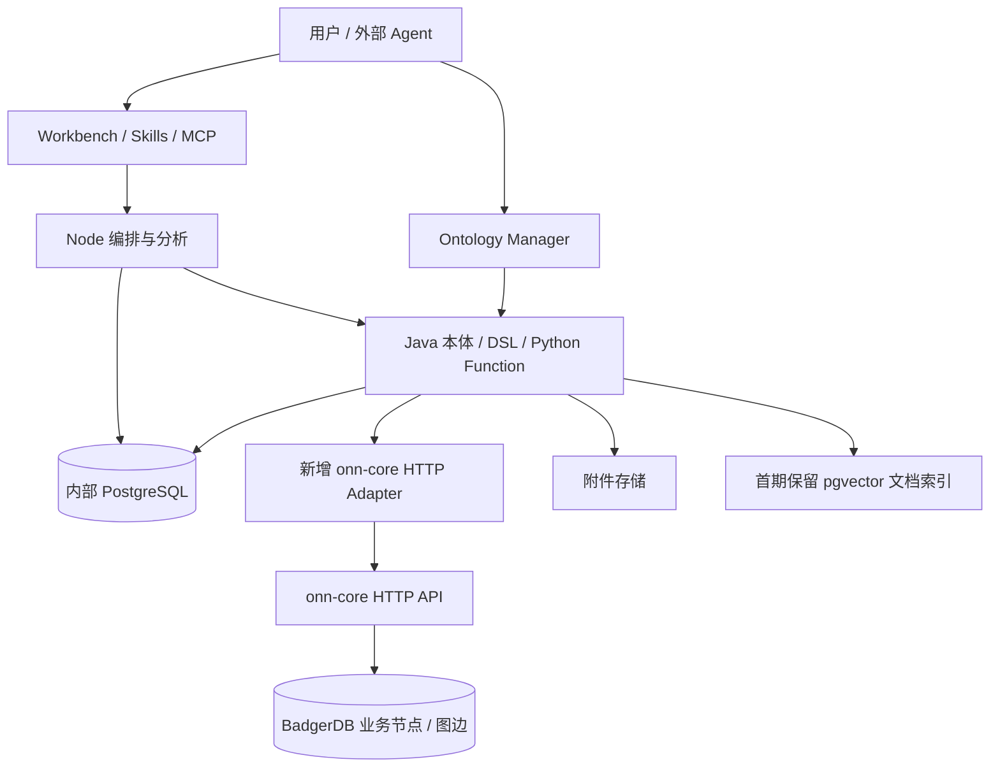

# Ontomato 接入 onn-core：业务数据迁移与 PostgreSQL 分工评估

核查日期：2026-10-09。Ontomato 基线为 `55fa178` / `4.0.0-beta.1`；onn-core 基线为 `0abecb5`，`VERSION` 为 `v11.0.0`。本报告记录接入前的源码级可行性分析。后续已实现受限只读适配器，当前范围见[使用说明](onn-core-adapter.zh-CN.md)；服务器实际行为和团队需求见[实测报告](onn-core-live-probe-and-team-requirements.zh-CN.md)。

前期分析只读 `/Users/weichen/Documents/dev/onn-core`，未修改文件、启动服务或执行种子/E2E/负载测试。后续按用户授权只读探测了 `192.168.1.108`；未向远端迁移、seed 或写入业务数据。所有改造和报告保存在 Ontomato 中。

## 1. 结论与推荐

**推荐“业务对象、属性、关系放入 onn-core；管理、配置、对话、任务和执行证据继续放在 PostgreSQL”的分工。架构上可行，但当前不能作为 PostgreSQL 的完整等价替换直接上线。**

Ontomato 已经区分内部数据库与业务 datasource。接入 onn-core 的正确入口是 Java `DataAdapter`，并保留 Workbench、分析编排、MetricView/Python 和现有管理数据库。onn-core 是 Go + BadgerDB 的 HTTP 本体图服务，没有 PostgreSQL wire protocol；修改 JDBC URL 或替换 Compose 中的 PostgreSQL 容器不能完成接入。

进一步核查表明，**以历史 M3 的“类、对象、显式边”接入路径为参考，比照搬 PostgreSQL 的表/JOIN 实现更合适**。公开版已有相关接口与服务分支，但没有完整的 M3 adapter。应将其图操作契约泛化，再实现独立的 onn-core adapter；不是打开 `useM3` 后更换 URL。本报告第 11 节给出这一路径的具体边界。

当前约束下可以先在 **Ontomato 一侧**实现 schema 投影、只读 HTTP adapter、结果归一化与明确的查询能力限制。完整关联行、写入沙箱、事务、字段权限及 Edit 一致性存在额外门槛；若未来需要 onn-core 新接口或修正默认装配，应独立提出变更，不能在本轮或现有只读约束下修改它。

| 目标 | 判断 | 主要工作 |
| --- | --- | --- |
| 将业务对象与关系存入 onn-core | 可行 | Schema 转换、稳定 ID、显式边、迁移校验与所有写入方切换 |
| 查询现有 onn-core 数据，单对象筛选、投影、基础聚合 | 可行，适合首期 | HTTP adapter、DSL 编译、返回格式、权限与错误处理 |
| 关系存在性筛选或只返回末端对象 | 有可用原生能力，需逐类查询验证 | 区分根节点筛选与末端遍历语义 |
| 保持全部跨类投影、JOIN 计数、任意 DSL/MetricView 语义 | 不能直接保证 | 当前原生接口缺少别名绑定的关联行；小数据可在 adapter 组合，大规模需要更强接口 |
| 完整保留建模、Action、沙箱和图探索 | 需要较多改造 | 能力声明、旧 M3 分支抽象、schema 同步、边删除与完整清理 |
| 用 onn-core 原生 Action/Edit/权限替换同名产品能力 | 不适合首期 | 契约不同，默认 HTTP 装配也有缺口 |

架构依据：[DataAdapter](/Users/weichen/Documents/dev/Ontomato/packages/data-engine-core/src/main/java/io/ontomato/dataengine/dataAdapter/DataAdapter.java)、[Provider](/Users/weichen/Documents/dev/Ontomato/packages/data-engine-core/src/main/java/io/ontomato/dataengine/dataAdapter/DataAdapterProvider.java)、[Registry](/Users/weichen/Documents/dev/Ontomato/packages/data-engine-core/src/main/java/io/ontomato/dataengine/dataAdapter/DataAdapterRegistry.java)、[onn-core 启动](/Users/weichen/Documents/dev/onn-core/cmd/oms/main.go)、[存储客户端](/Users/weichen/Documents/dev/onn-core/internal/storage/client.go)。Ontomato 当前完整结构见[项目理解文档](/Users/weichen/Documents/dev/Ontomato/docs/project-understanding.zh-CN.md)。

## 2. 推荐的数据所有权



| 数据 | 推荐位置 | 原因 |
| --- | --- | --- |
| 客户、订单、资产、设备、供应商等业务实例 | onn-core | 原生节点与动态属性 |
| 对象之间的业务关系 | onn-core | 显式有向边，可以保留关系语义 |
| ONN 类、属性、关系的结构定义 | onn-core | 数据与实际结构由同一后端维护 |
| Ontomato ontomap、展示名、AI 解释、映射与同步版本 | PostgreSQL | 引擎仍以 ontomap 规划查询；它是 ONN schema 的产品投影 |
| 用户、角色、权限规则、连接配置、模型设置 | PostgreSQL | 管理数据与业务图分开；身份体系需另外接通 |
| 对话、分析任务、报告、查询事实、执行事件、检查点 | PostgreSQL | 当前 Node/Java 持久化可保留 |
| MetricView、Python Function、Ontomato Action 与知识卡定义 | PostgreSQL | 它们是产品执行资产，不是 ONN 节点的直接替代品 |
| 文档元数据与 pgvector 索引 | 首期仍用 PostgreSQL | 先保留对象 ID 关联、分块、附件及检索协议 |
| PDF/图片/原始附件 | 现有文件存储 | 向量数据库不自动承担原始文件存储 |

内部 PostgreSQL 中 Node 使用 `ontomato` 数据库，Java 使用 `datarag` 数据库。这是当前部署的管理与运行存储，不应和 BusinessConfig 中选择的业务数据库连接一起替换。[BusinessConfigDao](/Users/weichen/Documents/dev/Ontomato/packages/data-engine-core/src/main/java/io/ontomato/dataengine/dao/BusinessConfigDao.java)、[JSONRuleDao](/Users/weichen/Documents/dev/Ontomato/packages/data-engine-core/src/main/java/io/ontomato/dataengine/dao/JSONRuleDao.java)、[部署配置](/Users/weichen/Documents/dev/Ontomato/deploy/docker-compose.ghcr.yml)支持这种分离。

保留用户/权限表不代表认证已经可用。公开 Ontomato 当前采用固定 `system/default` 身份，未提供完整登录和租户隔离；后续要从 PostgreSQL 中的真实身份与授权结果向业务查询链传递可信上下文。

## 3. 接入位置与需要调整的边界

建议新增 `packages/data-adapters/onn-core`，包含 `OnnCoreAdapterProvider`、HTTP client、schema/ID mapping、DSL compiler 和返回值转换；`apps/data-engine/pom.xml` 负责装配模块。业务实现放 packages，应用装配放 apps。

Provider 使用独立类型 `onn-core` 和 `sql=false`。Manager 已通过 `sql` 标志决定是否显示 SQL join 字段。但 **不要把 `useM3=true` 当作图数据库开关**：Admin 建类/改属性、DataService 邻居查询有直接发送旧 M3 MQL 的分支，会绕过新 adapter。应把 schema mutation、graph exploration、object identity 等能力从历史 M3 模式中抽离。

首期 adapter 可返回 `useM3=false`，使用 ontomap 的主键定义，并承接已有查询与对象/边操作入口。该值不会禁止显式图边，也不会自动禁用未实现的写入或建模；能力控制必须另做。完整图接入再逐步替换 M3 专用分支，详见第 11 节。

目前连接 DTO/保存/表单只认 `url/user/password`。受限内部 HTTP 连接可以先只用 URL；token、可信角色转发、tenant、超时与 TLS 等配置需要正式扩展契约，不能仅往 Provider 的字段列表里加一个名称。

`DataAdapter` 没有物理 schema discovery 方法；`DBSchemaUtil` 只把已保存 ontomap 转成 Markdown。接入 `/schema/all`、`/schema/meta` 需要新增读取/导入路径。ontomap 导入导出逐项拷贝字段，新增映射字段必须同步后端转换、contracts 与 Manager，或先用 PostgreSQL 中独立的映射记录保存，不能假设未知 JSON 字段会保留。

首期可增加明确的能力声明，例如查询、写入、建模、沙箱、向量和图探索。服务端据此拒绝未支持操作，前端同步隐藏或禁用入口；不能让 Python Action 走到运行时才发现 `createNamespace` 不可用。

依据：[应用装配](/Users/weichen/Documents/dev/Ontomato/apps/data-engine/pom.xml)、[连接 DTO](/Users/weichen/Documents/dev/Ontomato/packages/data-engine-core/src/main/java/io/ontomato/dataengine/dataAdapter/DataAdapterConnection.java)、[连接保存](/Users/weichen/Documents/dev/Ontomato/packages/data-engine-core/src/main/java/io/ontomato/dataengine/controller/BusinessConfigController.java)、[配置表单](/Users/weichen/Documents/dev/Ontomato/packages/workbench-ui/src/features/system/components/business-config/DataAdapterConfigCard.vue)、[Manager join 字段](/Users/weichen/Documents/dev/Ontomato/packages/ontology-manager/src/visual-modeling/VisualModeling.vue)、[AdminServiceImpl](/Users/weichen/Documents/dev/Ontomato/packages/data-engine-core/src/main/java/io/ontomato/dataengine/service/impl/AdminServiceImpl.java)、[DataServiceImpl](/Users/weichen/Documents/dev/Ontomato/packages/data-engine-core/src/main/java/io/ontomato/dataengine/service/impl/DataServiceImpl.java)、[DBSchemaUtil](/Users/weichen/Documents/dev/Ontomato/packages/data-engine-core/src/main/java/io/ontomato/dataengine/util/DBSchemaUtil.java)。

## 4. 数据与本体模型如何转换

| Ontomato / 关系数据库 | onn-core | 接入注意点 |
| --- | --- | --- |
| `class.name` / 表 | `OntologyClass.path` | 使用显式映射，不靠字符串猜测命名空间 |
| `showName` / `desc` | `name` / `description` | 产品侧覆盖说明需与结构定义分开管理 |
| 属性 `name` / 列 | `AttributeDef.name` | 保留字段含义、单位、枚举和展示约定 |
| `varchar/text` | `string` | 区分内容字符串与标识符 |
| `int/long` | `int` | HTTP 动态数值通常是 float64，大整数需无损策略 |
| `double` | `float` | 金额精度要单独确认，原生类型没有 decimal |
| `date/timestamp` | `datetime` | 冻结时区、日界线、空值及格式 |
| 一行主键 | `Instance.id` | Ontomato 每类仍要求唯一启用的 varchar 主键 |
| `fromField/toField` join | `RelationClass` + `Edge` | 必须真实创建边；保留外键属性不会自动形成图 |
| 文档 vector 属性 `[{path,text}]` | 原生 vector 是数值向量 | 两者含义不同，首期不要同名直映射 |

例如 `orders.customer_id = customers.id` 在当前 PostgreSQL adapter 中可运行时 JOIN；迁入 ONN 后需要 `/sales/order`、`/sales/customer` 两个类、`/sales/order_customer` 关系，以及每笔订单对应的显式边。

以下是**未来导入设计示例，未执行**。统一使用稳定字符串 ID，并把用于精确过滤的 ID 同时列为 schema 属性：

```json
{
  "id": "sales_order_1001",
  "classPath": "/sales/order",
  "attributes": {
    "id": "sales_order_1001",
    "source_id": "1001",
    "status": "shipped",
    "amount_minor": 12500
  }
}
```

```json
{
  "relationPath": "/sales/order_customer",
  "fromId": "sales_order_1001",
  "toId": "sales_customer_2001"
}
```

ID 编码应覆盖数据源、对象类与原始主键，使用确定性的无碰撞编码；示例中的短名称不能替代正式编码规则。当前 ONN 属性/边 key 使用冒号分隔并有 `strings.Split` 解析，ID、class path、属性名不应直接带未处理的冒号。图缓存以 `node.ID` 为键，因此不能把订单与客户的相同裸数字主键当成全局节点 ID。

ONN `Instance.id` 独立于 `attributes`；GraphQuery 条件读取属性，不能假设 `where id=...` 自动命中实例顶层 ID。复制 ID 为属性或选择实际存在的唯一业务属性，有助于按单个源节点限定遍历；现有数据不满足时必须另做适配。Ontomato 的证据查询又有固定投影 `id` 与 String 强转的遗留点，需要统一答案、详情、关系、向量和证据身份。

结构权威建议先采用 **ONN → Ontomato 单向投影**：ONN 负责类/边结构，Ontomato 保存映射与查询说明，结构变化时对比 version/schemaHash 并使旧映射失效。首期 Manager 可编辑产品说明；修改物理结构应先受限，避免两边都可改且无同步协议。

依据：[ONN schema](/Users/weichen/Documents/dev/onn-core/internal/domain/schema.go)、[实例](/Users/weichen/Documents/dev/onn-core/internal/domain/instance.go)、[图边](/Users/weichen/Documents/dev/onn-core/internal/domain/graph.go)、[key 编码](/Users/weichen/Documents/dev/onn-core/internal/storage/keys.go)、[图缓存](/Users/weichen/Documents/dev/onn-core/internal/storage/graph_cache.go)、[属性条件](/Users/weichen/Documents/dev/onn-core/internal/domain/executor.go)、[Ontomato PK 校验](/Users/weichen/Documents/dev/Ontomato/packages/data-engine-core/src/main/java/io/ontomato/dataengine/service/impl/AdminServiceImpl.java)、[固定 id 证据投影](/Users/weichen/Documents/dev/Ontomato/packages/data-engine-core/src/main/java/io/ontomato/dataengine/util/DslUtil.java)、[节点 ID 消费](/Users/weichen/Documents/dev/Ontomato/packages/data-engine-core/src/main/java/io/ontomato/dataengine/util/HttpRequestUtil.java)。

## 5. 查询兼容性是主要工作量

### 5.1 现有 ABC 兼容接口不能直接透传

ONN 已有 `POST /api/v1/query/execute-abc-dsl`，并有历史 DataRAG/M3 接入文档，这是有用的参考。但它支持的 ABC JSON 与 Ontomato 当前实际 DSL 存在明显差异：

| 方面 | Ontomato 当前 DSL | ONN ABC translator | 结果 |
| --- | --- | --- | --- |
| 关系 | `from/to` 数字索引、`type[]`、`min_hops/max_hops` | `relation_path/fromObject/toObject/direction` | 需要真正编译关系结构 |
| 条件 | 别名 `variable`，符号操作符和组合条件 | 读取 field/operator/value，忽略 variable | 条件可能施加到错误对象 |
| 跨类输出 | fields 带对象别名 | 输出只读单一 Instance 的属性，忽略 variable | 不能保留跨类字段绑定 |
| 排序 | `sort.fields[]` 多字段 | `order_by` 单字段 | 需要能力限制或完整结果后排序 |
| 分页 | `limit:{count,offset}` | `limit/offset` 整数 | 直接传会发生 JSON 解析错误 |
| 分组 | `group_by.fields/having` | ABC output 未接这套字段 | 需编译为 native AST |
| 多步 | `save_table` 与后续临时结果引用 | 只给步骤命名，没有生成 `from_step` | 不能自动保留步骤依赖 |
| 多 pattern | 图模式可含多个对象/关系 | 反复覆盖 Traverse，关系按数组串成链 | 不是一般模式匹配 |

translator 未知聚合函数会默认 count，也没有严格拒绝所有未识别字段。适配器应在调用前校验能力，未支持语义明确失败，避免正常 HTTP 返回掩盖错误答案。优先编译为 `/query/execute` 或 `/query/pipeline` 的 native AST，并保留自己的兼容检查。

依据：[Ontomato 关系示例](/Users/weichen/Documents/dev/Ontomato/packages/data-engine-core/conf-defaults/dslExample/relationships.json)、[输出示例](/Users/weichen/Documents/dev/Ontomato/packages/data-engine-core/conf-defaults/dslExample/output1.json)、[ONN ABC translator](/Users/weichen/Documents/dev/onn-core/internal/domain/abc_dsl_translator.go)、[ABC handler](/Users/weichen/Documents/dev/onn-core/internal/api/handlers.go)、[真实路由](/Users/weichen/Documents/dev/onn-core/internal/api/router.go)。

### 5.2 节点集合和关联行不是相同的结果模型

ONN native GraphQuery 包含 `match_class`、属性条件、`traverse/traverses`、聚合、分组、having、时间分桶与 pipeline。它具备可用查询基础，但当前 executor 最终返回 **一个类的 Instance 集合**：

- 单链遍历合并并去重目标 ID，返回最后一跳对象。
- 星形多分支筛选返回源对象；任一符合条件的邻居即可让该源通过分支。
- 投影只从最终 Instance 的 `attributes` 取值，没有 `order/customer` 等变量绑定元组。
- count 计算节点集合数量；不保留关系 JOIN 产生的一对多行数。

例如两笔订单属于同一客户：遍历到客户并去重后只有一个客户，不能拿这个 count 解释为两笔订单。要求每行同时输出订单号和客户名时，必须保存订单—客户的绑定；单纯转换字段名不能恢复已经丢失的绑定信息。

**首期候选查询范围**：单类筛选与投影、单类基础 count/sum/avg/min/max/count_distinct、已核对的分组/时间分桶、明确返回末端对象的遍历，以及受限制的根节点关系存在性筛选。每项还需验证 null、重复值、时间与过滤/聚合/分页顺序。原生 count 是节点数，不能直接映射为 SQL 的 count(非空字段)；eq/neq/in 使用字符串化比较，范围比较转浮点，未提供 SQL IS NULL/NOT IN 等操作符，必须由 adapter 规定类型语义或拒绝。

还有会静默漏条件的请求形状：同层 where_logic 替代 where，单链目标未执行 where_logic，多分支只检查直接邻居的 Where 而不递归执行其深层遍历；from_step 未重新应用 Where/WhereLogic，且只检查 Traverse，未检查 Traverses。adapter 必须合并逻辑树并限制可下推形状，其余拆解执行或明确拒绝。Pipeline 的 from_step 传递候选节点 ID，不能替代 Ontomato 的临时关联表；分组行 group_N 也不是原始业务节点，不能直接用作证据 ID。

小规模静态图可以由 Java 多次取数并构建关联行，或完整取出有限边集后 hydrate 对象。当前公共 HTTP 只有 edge-sample，没有按源批量邻接/分页边扫描/一致性快照接口；不能直接调用 Go 内部的批量邻居方法。sample 没有完整性游标或边属性，不能把默认几条样本当全量。当前 limit 没有最大值 clamp：在无并发变更、成功读取且 key 编码有效的有限数据集上，可以请求 B+1 条，返回数大于 B 就拒绝，否则获得该次读取的有限完整边集。但 repository 先扫描整个关系的全部 key，再截取 N 条，B 不能限制后端扫描内存。shape 的 total_edges 另受扫描限额与缓存影响，不能替代完整性证明。此路径需已知小数据边界与查询期间数据不变的约束，不能作为通用大规模 JOIN 后端。

多分支的 branch_limit 默认 10000，达到上限直接停止，没有 truncated/has_more/complete 标志。被截断的多个分支再求交集后，最终返回行数可能很小；只检查最终行数无法发现不完整结果。必须主动限制并证明每个分支完整，否则拒绝执行，不能把部分结果包装成完整业务答案。

native 排序目前单字段；分组聚合的执行分支没有处理 MetricExpr，不能因为 AST 接受 expr 就宣布分组算术已支持。表达式可由 adapter 在**完整**基础聚合之后计算，再依次 having、排序、分页；拿到已分页数据后再计算会改变答案。

大型关联查询若要高效、可证明地等价，需要返回别名绑定行/路径证据、批量邻接或等效执行 API，并解决多次读取的一致性。这些属于未来 ONN 接口需求，本次不实现。当前 PostgreSQL adapter 本身也仅处理数组首项、pattern 首项和有限多步；应以实际产品查询与已发布 MetricView 建兼容语料，而不是声称支持抽象 DSL 的全部语法。

依据：[native AST](/Users/weichen/Documents/dev/onn-core/internal/domain/dsl.go)、[executor](/Users/weichen/Documents/dev/onn-core/internal/domain/executor.go)（executeLegacy、applyProjection、resolveStepWithIDs、resolveSingleBranchSourceIDs、groupedAccumulator）、[SampleEdges](/Users/weichen/Documents/dev/onn-core/internal/domain/graph.go)、[SampleEdges handler](/Users/weichen/Documents/dev/onn-core/internal/api/handlers.go)、[PostgreSQL compiler](/Users/weichen/Documents/dev/Ontomato/packages/data-adapters/postgresql/src/main/java/io/ontomato/dataengine/dataAdapter/PostgreAdapter.java)。

### 5.3 结果、错误与证据需要兼容

Ontomato adapter 当前返回 `[{"answer":[扁平行],"mqls":[实际查询]}]`，不是 ONN ABC bridge 的外层 `{status,data:[...]}`，也不是 native `{matched_count,data,projected,metrics}`。Java 适配器要把结果统一为现有 answer 格式，将原生计划/请求记录放入执行证据，保留 Node harness 帧、Python code、`outKeyRefs`、session/node 关联和取消语义。matched_count 是本次返回行数，不能当分页前总数；普通 metrics 在分页前计算，需要分别处理。

证据建议保存 backend、schema/mapping 版本、原始 Ontomato DSL、实际 ONN 查询、响应状态、对象 ID/关系依据与数据时间。不能只保存生成 SQL 的旧字段，却仍让用户以为证据来自 PostgreSQL。

ONN Query 有 10 秒 fallback timeout；可选 guards 还可能返回 HTTP 200 + `degraded=true` 的空结果。适配器必须识别降级、超时与缺失数据，并主动证明结果完整性，不能仅以 200 判成功；原生分支静默截断没有可供直接识别的标志。HTTP 取消与 Node 现有更长的问答超时也需对齐，且不能在写入超时后未经幂等确认就重复提交。

历史 MetricView/Action、已验证答案卡和报告配方需带 backend/schema/mapping 版本并重新验证；数据迁移不意味着旧代码及聚合语义自动保持有效。

依据：[PostgreSQL 返回格式](/Users/weichen/Documents/dev/Ontomato/packages/data-adapters/postgresql/src/main/java/io/ontomato/dataengine/dataAdapter/PostgreAdapter.java)、[结果处理](/Users/weichen/Documents/dev/Ontomato/packages/data-engine-core/src/main/java/io/ontomato/dataengine/util/HttpRequestUtil.java)、[Node harness](/Users/weichen/Documents/dev/Ontomato/packages/workbench-server/src/services/data-query/branches/abc-harness-branch.ts)、[ONN handler](/Users/weichen/Documents/dev/onn-core/internal/api/handlers.go)、[resilience guards](/Users/weichen/Documents/dev/onn-core/internal/api/resilience_guards.go)。

## 6. 写入、Action 与沙箱

ONN 有实例 create/update/patch/delete/upsert/batch，图边仓库支持增删；这足以作为业务数据导入和基础对象维护的基础。实例+exact index 与实例批量操作使用一次 Badger `Update` 事务；一对出入边也原子写入。这个原子边界不能扩展解释为整个业务 Action 原子。

当前 ONN Action 逐个提交 Effect；后一个失败时，前一个已发生的写入不会自动回滚。create/modify/delete Effect 先修改 Base，再可选记录 Edit，Edit 写入错误有忽略路径。原生 Action 的 typed Effects/审批与 Ontomato 的 Python WRITE Function 不是同一个执行协议，首期保留后者，通过 adapter 执行受支持的操作。

原生 Action 未接入查询/节点缓存的统一失效链；PATCH、Batch、Action 也未同步维护向量索引，未发现对应的 RemoveVector。一次底层写入成功不证明后续 GET、缓存查询、图探索与向量检索立即一致。只改 Ontomato 的方案必须先验证现有受支持写入路由的失效效果；若无法通过公开 API 保证一致性，应暂时禁用相关写入或向量功能。

还有三项具体差异：

1. router 只有 `POST /data/edge`，没有通用 `DELETE /data/edge`。现有原生 `remove_link` Action 可以作为未来桥接候选，但需要管理该 Action 的定义、参数、身份和审计，不能假定 DELETE 路由存在。
2. 删除实例的路径删除属性与 exact indexes，未同时清理关联边。删除类/关系 schema 和 purge-domain 也只删定义，不能充当沙箱数据清空。
3. Ontomato Action 生成/测试会创建临时类、关系与数据，最后 truncate/drop。ONN path 前缀不是自动租户或安全沙箱；要用独立实例或严格命名空间+完整清理清单，并验证从测试环境无法读取或写入生产对象。

写入还要规定 PATCH 与替换的区别、where 更新的命中全集、删除/重挂关系、重复提交、并发修改与失败补偿。PostgreSQL 管理记录与 ONN 业务数据之间没有跨库事务，审批/执行状态应使用可恢复的执行记录、幂等 ID 与核对流程；首期不要承诺全局原子提交。

依据：[实例批量事务](/Users/weichen/Documents/dev/onn-core/internal/domain/instance.go)、[Badger WriteBatch](/Users/weichen/Documents/dev/onn-core/internal/storage/kv.go)、[边增删](/Users/weichen/Documents/dev/onn-core/internal/domain/graph.go)、[ONN Action executor](/Users/weichen/Documents/dev/onn-core/internal/domain/action_executor.go)、[默认 Action 装配](/Users/weichen/Documents/dev/onn-core/cmd/oms/main.go)、[查询缓存](/Users/weichen/Documents/dev/onn-core/internal/domain/query_cache.go)、[写入 handler](/Users/weichen/Documents/dev/onn-core/internal/api/handlers.go)、[router](/Users/weichen/Documents/dev/onn-core/internal/api/router.go)、[schema 删除](/Users/weichen/Documents/dev/onn-core/internal/domain/schema_repo.go)、[Ontomato Action 沙箱](/Users/weichen/Documents/dev/Ontomato/packages/data-engine-core/src/main/java/io/ontomato/dataengine/service/impl/ActionServiceImpl.java)、[SandboxService](/Users/weichen/Documents/dev/Ontomato/packages/data-engine-core/src/main/java/io/ontomato/dataengine/service/impl/SandboxServiceImpl.java)。

## 7. V11 指南与当前默认 HTTP 服务的差异

指南适合了解目标功能，但不能直接作为当前集成接口契约。核查发现：

| 指南内容 | 当前源码情况 | 集成处理 |
| --- | --- | --- |
| GraphWhere 例子使用 `rootClass/traversals` 和对象形式 where | AST 实为 `match_class`、`traverse/traverses`、`where:[]` | 从真实 DTO 冻结请求样例 |
| batch 示例使用 `instances:[]` | handler 要求 `operations:[]`，空操作返回 400 | 导入器使用真实操作协议 |
| schema 示例 `security_marking/read_roles` | JSON tag 实为 `securityMarking/readRoles/writeRoles`；没有兼容反序列化 | 未识别字段会被忽略，不能按示例认定已设置策略 |
| 属性级自动读写过滤 | PropertySecurityFilter 存在，但生产 handler/executor 未发现调用装配 | 不能当作已生效的防线 |
| Edit merged/history/revert/snapshot 可用 | `cmd/oms/main.go` 未装配 EditRepo/MergeEngine；部分示例参数也不匹配 | 按当前默认入口，有效参数下相关接口会提示未启用；独立装配需另验 |
| Base/Edit 隔离与普通查询回滚 | 普通查询用 InstanceRepository；Action 直接修改 Base | Edit revert 不等于恢复普通查询看到的 Base |
| Action 事务/原子效果 | Effect 顺序独立提交 | 必须实测并设计补偿，不能自动承诺回滚 |
| 文档测试“预期 100%”与性能倍率 | 不是本次测试记录；没有实际执行或复现 | 不据此估算业务查询容量或生产 SLA |

权限还需要独立处理：ResourceAuthorizer 的 `OMS_RESOURCE_GOVERNANCE_ENABLED` 默认关闭；身份和角色直接来自 `X-OMS-*` 请求头，Action 在缺少 roles 时默认 admin，审批角色也读取客户端参数。把用户/角色放 PostgreSQL 是正确的持久化分工，但还需要可信认证入口、角色映射与禁止客户端自报权限的服务边界。

在不改 ONN 源码的首期，可以限制 ONN 仅接受受信 Java 服务请求，Java 执行授权后的 DSL 并控制可调用路由；不过不能只做最终列遮罩，因为未授权字段仍可能参与筛选/统计。需要先验证行过滤、字段依赖、聚合、详情、样本、向量、Manager、MCP 与 Python 的整条路径。现有 ABC handler 与部分旁路未统一执行 native Query 的授权逻辑，不应开放给最终用户直连。

依据：[用户指定指南](/Users/weichen/Documents/dev/onn-core/docs/ONN_CORE_V11_USER_AND_TESTING_GUIDE.md)、[Schema DTO](/Users/weichen/Documents/dev/onn-core/internal/domain/schema.go)、[handlers](/Users/weichen/Documents/dev/onn-core/internal/api/handlers.go)、[PropertySecurityFilter](/Users/weichen/Documents/dev/onn-core/internal/domain/property_security.go)、[资源授权开关](/Users/weichen/Documents/dev/onn-core/internal/domain/resource_governance.go)、[Action 身份](/Users/weichen/Documents/dev/onn-core/internal/api/action_handler.go)、[审批](/Users/weichen/Documents/dev/onn-core/internal/api/approval_handler.go)、[Edit handler](/Users/weichen/Documents/dev/onn-core/internal/api/edit_handler.go)、[默认装配](/Users/weichen/Documents/dev/onn-core/cmd/oms/main.go)、[merge engine](/Users/weichen/Documents/dev/onn-core/internal/domain/edit_merge.go)。

## 8. 文档向量、持久化与部署

首期保留 Ontomato 的 pgvector 与附件子系统。结构化对象放 ONN，文档命中后仍由已有逻辑把对象 ID 加入 DSL 条件，adapter 再映射到 ONN 对象。这样可以先验证结构化替换，避免同时改变文档切块、资源生命周期、embedding 模型、维度、距离/阈值与对象过滤。

如果后续迁移到 ONN HNSW，需要明确一个文档块/多个文件怎样建模与索引，保留原始附件、引用和删除传播，核对维度与模型版本，并验证近似检索与 structured filter 的语义。ONN 存在 HNSW 重建/预热代码；不能把它理解成与当前 pgvector 文档协议相同的组件。

默认 ONN 启动若未设置 `OMS_DATA_DIR`，使用 InMemory；持久化模式 `WithSyncWrites(false)`，正常关闭与突发掉电的持久性边界不同。当前是嵌入 Badger 的单服务设计；运维文档提供停服复制数据目录的备份/恢复流程，本次未发现完整的在线备份/恢复/复制 HTTP 管理能力，也未验证高可用部署。替换承载正式业务的 PG 前必须明确磁盘卷、恢复演练、异常停止后数据/索引一致性与可接受的恢复目标，不能直接按 PostgreSQL 运维方案推定。

依据：[文档向量写入](/Users/weichen/Documents/dev/Ontomato/packages/data-engine-core/src/main/java/io/ontomato/dataengine/service/impl/WriteFunctionOperationServiceImpl.java)、[向量 DSL 转换](/Users/weichen/Documents/dev/Ontomato/packages/data-engine-core/src/main/java/io/ontomato/dataengine/util/DslUtil.java)、[ONN VectorEngine](/Users/weichen/Documents/dev/onn-core/internal/domain/vector_engine.go)、[启动持久化配置](/Users/weichen/Documents/dev/onn-core/cmd/oms/main.go)、[Badger 同步设置](/Users/weichen/Documents/dev/onn-core/internal/storage/client.go)、[停服备份说明](/Users/weichen/Documents/dev/onn-core/docs/product/11_系统运维.md)。

## 9. 迁移与开发顺序

### 阶段 A：冻结契约与受限只读 PoC

只在 Ontomato 实现 schema 投影、已有稳定身份的映射与 round-trip 校验、HTTP adapter、native DSL compiler、answer/证据归一化、超时与 unsupported 检查。只读阶段不能通过重写 ONN 实例补齐 ID 属性，适配已有顶层 ID 与属性，不满足条件时限制查询。首期即通过服务端能力检查和 Manager/UI 控制禁用建类、改物理属性、Action、沙箱等未支持入口。先连接已有 ONN 中的测试数据或以后授权的独立测试实例；目前不迁移、不写 ONN。优先验收单类查询、基础聚合和明确定义的关系筛选。

样本缓存也应纳入阶段 A。现有 HttpRequestUtil 按 adapter 提供的文件名缓存，PostgreSQL 文件名仅包含类名；切换数据源后可能继续给 Planner 旧样本。新 adapter 缓存键应覆盖 backend、数据源、schema/mapping 版本，并在映射或查询字段变化时失效，避免跨数据源混用。依据：[样本缓存](/Users/weichen/Documents/dev/Ontomato/packages/data-engine-core/src/main/java/io/ontomato/dataengine/util/HttpRequestUtil.java)、[PostgreSQL 缓存文件名](/Users/weichen/Documents/dev/Ontomato/packages/data-adapters/postgresql/src/main/java/io/ontomato/dataengine/dataAdapter/PostgreAdapter.java)。

此阶段不要同时启用 ONN 自然语言/AI planner 替代 Ontomato 规划。先复用 Ontomato 的 Planner/Harness，能把差异定位在查询 adapter；更换整个规划链会同时改变质量检查、学习与可追溯协议。

### 阶段 B：代表性关联语义与产品能力

挑选真实 MetricView 和常见多对象问题，检验一对多、多对多、跨类输出、分页、group/having 与证据。小数据 adapter 组合要明确规模和一致性限制；无法完整支持时拒绝。若正式业务依赖大规模关联行，应把必要的 ONN API 能力单列为后续设计，本轮不改其代码。

扩展读图探索、schema 变化检测与 Manager 对新增能力的控制。历史配方按 backend/schema/mapping 版本重新验证；阶段 B 通过后才能把这些能力标记为受支持。

### 阶段 C：业务数据导入与基础写入

未来获得数据迁移授权后，按以下顺序执行：

1. 盘点业务表、PK/FK、nullable、decimal、时间、所有写入应用和存量配方；选择 ONN 数据权威与切换方式。
2. 从一致性 PostgreSQL 快照导出并转换 Schema，再分批导入节点，最后生成显式边；用确定性 ID 和批次记录支持幂等恢复。
3. 对账节点数、关系数、源外键/边对应、孤儿边、关键金额和分组统计；不能只看导入 HTTP 成功数。
4. 快照后的增量由 CDC 或明确的冻结窗口处理。若原业务应用仍写 PG，则 ONN 只是镜像，不能宣布业务库已替换。
5. 切换查询和所有业务写入；稳定期间保留 PG 源快照作为核对与回退依据。回退还需回灌切换后新增数据，不能仅改 URL。

### 阶段 D：Action、沙箱与原生能力

在基础写入、删除边/孤儿处理、幂等与并发恢复验收后，再启用 Python WRITE/Action 和隔离测试环境。原生 ONN Action、Edit、推理、向量可以逐项接入；每一项都需要明确其事实所有权和默认装配，不按名字相同整体替换。

## 10. 验收门槛与尚缺信息

| 验收场景 | 必须证明的结果 |
| --- | --- |
| ID 与大整数 | 跨类同裸 PK 不冲突；ID round-trip；超安全整数/金额不丢精度 |
| 单对象查询 | 等值、范围、and/or、in、空值、文本匹配与别名正确；不支持项明确报错 |
| 复杂条件与 Pipeline | 同层逻辑、目标 OR、深层星形分支、from_step 再过滤正确执行或明确拒绝；不能静默漏条件 |
| 两笔订单属于同客户 | 订单数为 2，客户去重数为 1；订单与客户字段绑定正确 |
| 多对多关系 | 关联行、distinct、sum 不因节点去重或重复边而改变 |
| 分组与时间 | group/having、表达式、时区、日/月边界和空集语义与约定一致 |
| 排序/分页 | 多字段和同值时有稳定顺序；分页不提前影响全局聚合 |
| 证据与旧配方 | 来源对象/关系可定位；schema 改变后旧 mapping/卡片不能静默复用 |
| 降级和取消 | HTTP 200 + degraded、超时、断连与不完整结果不会变成“成功的空答案” |
| 查询上限与完整性 | B−1/B/B+1、截断分支的交集均有确定处理；小规模组合查询不能扩大成无边界扫描 |
| 权限 | 匿名与自报 admin 不能越权；详情、样本、向量、MCP、Python 与统计都遵循同一身份 |
| 写入与失败 | 重复提交、后续 Effect 失败、并发更新、边重挂、删对象与删边可恢复并可审计 |
| 缓存与索引一致性 | 预热缓存后变更对象/关系，GET、查询与图结果及时一致；后续启用 ONN 向量时验证增改删检索一致性 |
| 测试环境清理 | 临时类/节点/边/索引全部清理；生产数据无法被测试命名空间操作 |
| 持久化与容量 | 异常停止、重启、索引重建与恢复可验证；真实数据规模下延迟/内存达标 |

还缺正式业务的数据量/边数/增长率、需要保持的 MetricView/Action、是否允许短暂停写、精确金额需求、租户权限范围、部署与恢复目标。它们影响实施工作量与能否接受 adapter 组合查询，目前不据源码给出“几天完成”或性能承诺。

**当前适合进入阶段 A 的设计与实现准备。业务图落在 onn-core、管理层继续用 PostgreSQL 是清晰的目标架构；能否完成全部业务库切换，要由关联查询、写入一致性、权限和恢复验收决定。**

## 11. 以 M3 模式为参考的接入方案

### 11.1 为什么 M3 是更合适的参考

M3 路径按类路径、对象身份与显式边处理业务数据；onn-core 的 `OntologyClass`、`Instance`、`RelationClass/Edge` 与之更接近。它可以指导 schema 映射、对象维护、边操作、沙箱身份与实例图设计，而不必让 ONN 模拟关系数据库的物理表或 SQL。

公开源码的 `DataAdapter` 已含 `createClass`、`createEdgeType`、对象增删改、`createEdge/deleteEdge` 和沙箱类名/对象 ID 转换。WriteFunction 的边操作及 Sandbox 的关系插入直接调用这些方法，没有 `useM3` 条件；所以独立 ONN adapter 即使返回 `useM3=false`，也能承接显式边操作。这里只确认接入入口，尚不代表 ONN 的所有删除、事务和清理能力已经满足契约。

| 可参考的设计 | onn-core 对应概念 | 接入处理 |
| --- | --- | --- |
| 路径形式的类 | `OntologyClass.path` | schema 读取与 ontomap 投影；保存显式路径映射 |
| 业务对象 | `Instance` | 对象 ID、主键属性与产品节点引用统一转换 |
| 命名的显式边 | `RelationClass`、`Edge` | 关系名称映射到 relation path，创建真实边 |
| DSL 经 adapter 执行 | native Query/Pipeline | 编译受支持语义，归一化答案与执行证据 |
| namespace 与沙箱身份 | 类路径前缀、独立测试实例 | 定义真实隔离、数据清理与恢复协议后启用 |
| 图邻居与对象详情 | 图查询及实例读取 | 新增通用图能力，处理边类型与节点身份 |

依据：[DataAdapter 图契约](/Users/weichen/Documents/dev/Ontomato/packages/data-engine-core/src/main/java/io/ontomato/dataengine/dataAdapter/DataAdapter.java:24)、[WriteFunction 边操作](/Users/weichen/Documents/dev/Ontomato/packages/data-engine-core/src/main/java/io/ontomato/dataengine/service/impl/WriteFunctionOperationServiceImpl.java:96)、[Sandbox 关系插入](/Users/weichen/Documents/dev/Ontomato/packages/data-engine-core/src/main/java/io/ontomato/dataengine/service/impl/SandboxServiceImpl.java:108)、[ONN schema](/Users/weichen/Documents/dev/onn-core/internal/domain/schema.go:141)。

### 11.2 三个“模式”不能混为一谈

| 名称 | 当前实际职责 | 对 ONN 的含义 |
| --- | --- | --- |
| `BusinessConfig.dataAdapter` | Registry 按类型找到已装配 Provider | 新增独立 `onn-core` 类型，是实际后端入口 |
| `DataAdapterProvider.sql()` | 查询语言元数据；Manager 据此显示/校验 JOIN 字段 | 设为 false 适合显式边建模；不会自动切换执行器或开启图界面 |
| `DataAdapter.useM3()` | M3 专用 schema、MQL、身份与邻居分支 | 保留历史含义，首期 ONN 返回 false，后续抽离为能力接口 |
| `M3Mode.V0/V1` | DSL 服务中的 raw / data movement resolution 参数 | 不是后端选择；PostgreSQL adapter 也接收它且仍执行 SQL |

`getM3Data` 的历史名称也不代表它直接访问 M3：普通 DSL 最终调用 `adapter.executeDsl`。这一执行入口和上层 Planner/Harness 可以保留。

目前根 Maven 列出七个关系型 adapter 模块，data-engine 应用只装配 PostgreSQL；本次在公开 checkout 未找到真正的 M3 Provider/Adapter。测试中的 M3 provider 是 mock，配置中的 M3 字段也不能证明该版本可直接运行 M3。当前参考对象是公开接口和历史服务分支，不是一个现成可换 URL 的驱动。

依据：[Provider 的 sql 元数据](/Users/weichen/Documents/dev/Ontomato/packages/data-engine-core/src/main/java/io/ontomato/dataengine/dataAdapter/DataAdapterProvider.java:20)、[Registry 后端选择](/Users/weichen/Documents/dev/Ontomato/packages/data-engine-core/src/main/java/io/ontomato/dataengine/dataAdapter/DataAdapterRegistry.java:29)、[模式枚举](/Users/weichen/Documents/dev/Ontomato/packages/data-engine-core/src/main/java/io/ontomato/dataengine/util/HttpRequestUtil.java:34)、[统一执行委派](/Users/weichen/Documents/dev/Ontomato/packages/data-engine-core/src/main/java/io/ontomato/dataengine/util/HttpRequestUtil.java:272)、[根模块列表](/Users/weichen/Documents/dev/Ontomato/pom.xml:19)、[应用装配](/Users/weichen/Documents/dev/Ontomato/apps/data-engine/pom.xml:26)、[Manager JOIN 控制](/Users/weichen/Documents/dev/Ontomato/packages/ontology-manager/src/visual-modeling/VisualModeling.vue:155)。

### 11.3 必须从 M3 分支中抽离的操作

| 当前入口 | M3 分支行为 | 对接 ONN 的调整 |
| --- | --- | --- |
| Admin 创建类/关系、增删属性 | 直接构造 `create class`、`create edge type`、`alter class` 等 MQL；部分判断读取 `/system/class` | 纳入 schema adapter 能力，以 ONN schema API 实现并记录同步结果 |
| DataService 全量实例图 | M3 `match` 返回 `message[].graph.nodes/edges` | 通用图结果契约；明确完整性、边类型与来源 |
| `queryNextByNode` | 直接发送入/出方向一跳 MQL；非 M3 返回不支持 | 新增 adapter 邻居能力；现有 ONN HTTP 邻接能力限制仍按第 5 节处理 |
| 对象详情、文档写回与向量条件 | 根据 `useM3` 选择隐式 `id` 或 ontomap PK，拼接/截取节点引用 | 抽离对象身份与定位契约，覆盖详情、证据、附件和图节点 |

历史 `getExecMQL/queryMql` 向 `m3SchemaUrl` POST 表单字段 `mql`，使用 `m3auth`，读取 `message`；另一方法 `insertOrUpdateMQL` 则 POST JSON `{mql,values}`。这些请求内容仍是 MQL，不同于 ONN 的 JSON schema/data/query 协议。因此把 ONN adapter 标成 M3 会让上述操作绕过 adapter，并发送 ONN 无法理解的 MQL。

schema 生命周期也不能逐段照搬：当前 `delRelationship` 只删除 ontomap 关系元数据，没有删除 M3 物理边类型。ONN 接入应分别定义“移除产品映射”“删除 schema”“删除实例/边”的行为，并保持同步可恢复。

依据：[建关系 MQL](/Users/weichen/Documents/dev/Ontomato/packages/data-engine-core/src/main/java/io/ontomato/dataengine/service/impl/AdminServiceImpl.java:131)、[建类 MQL](/Users/weichen/Documents/dev/Ontomato/packages/data-engine-core/src/main/java/io/ontomato/dataengine/service/impl/AdminServiceImpl.java:273)、[移除关系元数据](/Users/weichen/Documents/dev/Ontomato/packages/data-engine-core/src/main/java/io/ontomato/dataengine/service/impl/AdminServiceImpl.java:170)、[实例图 MQL](/Users/weichen/Documents/dev/Ontomato/packages/data-engine-core/src/main/java/io/ontomato/dataengine/service/impl/DataServiceImpl.java:276)、[邻居展开](/Users/weichen/Documents/dev/Ontomato/packages/data-engine-core/src/main/java/io/ontomato/dataengine/service/impl/DataServiceImpl.java:703)、[身份处理](/Users/weichen/Documents/dev/Ontomato/packages/data-engine-core/src/main/java/io/ontomato/dataengine/service/impl/DataServiceImpl.java:789)、[MQL transport](/Users/weichen/Documents/dev/Ontomato/packages/data-engine-core/src/main/java/io/ontomato/dataengine/util/HttpRequestUtil.java:328)。

### 11.4 直接影响实施的四个差异

**建边类型缺少端点定义。** `createEdgeType(namespace, edgeName)` 没有 source/target class，Sandbox 又以 `jsonRule=null` 创建 adapter；ONN `RelationClass` 需要 `sourceClass/targetClass`。应扩充关系定义参数，或提供可靠的映射上下文，不能仅凭边名猜端点。依据：[Sandbox 建边类型](/Users/weichen/Documents/dev/Ontomato/packages/data-engine-core/src/main/java/io/ontomato/dataengine/service/impl/SandboxServiceImpl.java:92)、[adapter 上下文](/Users/weichen/Documents/dev/Ontomato/packages/data-engine-core/src/main/java/io/ontomato/dataengine/service/impl/SandboxServiceImpl.java:124)。

**M3 ID 规则不等于 ONN ID 规则。** 接口文档约定 M3 的 `class:id` 与 sandbox 前缀；ONN 使用顶层实例 ID，底层 key 又包含冒号分隔。可保留产品展示引用，但进入 ONN 的真实 ID 必须单独编码，不能直接存 M3 的拼接值。答案、详情、证据与文档关联必须使用同一映射，详见第 4 节。

**本体类型图与实例图是两种产品能力。** 公开 Manager 的 OntologyPlayground 从 ontomap 构建类型/关系图，DataBrowser 是对象表格，均可用于新 adapter。本次在公开 Manager/Workbench 的非测试源码中未找到实例星图与邻居展开的调用入口。后端保留星图代码，不意味着现有 UI 已提供完整 M3 实例图体验。

非 M3 的 `cutWholeDataBySql` 实际生成关系 DSL 并调用 adapter，没有直接执行 SQL；支持两端绑定投影后 ONN 可以复用它。它只扫描双方 `inStarChart=true` 的关系，不包含孤立对象，仍依赖第 5 节的关联行能力。邻居接口则需独立改造。非 M3 全量星图与 M3 邻居结果都按 source/target 合并边，未保留关系类型，无法表达同一对节点之间的多种 ONN 关系。图结果应保留 relation path 和边身份。VisualModeling 还禁止同方向同类型端点再建关系，接入原生多关系时需统一建模入口。依据：[类型图](/Users/weichen/Documents/dev/Ontomato/packages/ontology-manager/src/components/OntologyPlayground.vue:125)、[数据表](/Users/weichen/Documents/dev/Ontomato/packages/ontology-manager/src/data-browser/DataBrowser.vue:225)、[非 M3 星图执行](/Users/weichen/Documents/dev/Ontomato/packages/data-engine-core/src/main/java/io/ontomato/dataengine/service/impl/DataServiceImpl.java:487)、[实例邻居结果](/Users/weichen/Documents/dev/Ontomato/packages/data-engine-core/src/main/java/io/ontomato/dataengine/service/impl/DataServiceImpl.java:703)、[建模端点限制](/Users/weichen/Documents/dev/Ontomato/packages/ontology-manager/src/visual-modeling/VisualModeling.vue:1002)。

**ONN 的历史 ABC bridge 只是部分兼容入口。** ONN 文档确实描述过 DataRAG 从 M3 改 URL 接入 ABC DSL；这证明设计上已有对接意图，但当前 bridge 没有 M3 schema MQL 或图 `nodes/edges` 协议，且 DTO、响应外壳、别名条件和跨类输出与当前 Ontomato 不一致。不能以历史文档中的“零修改”描述替代本次源码核查。优先由 ONN adapter 校验并编译到 native Query/Pipeline，见第 5 节。依据：[历史 ABC 接入指南](/Users/weichen/Documents/dev/onn-core/docs/06_外部Agent生态对接/ONNCore_V6.3_ABCDSL_接入指南.md)、[当前 translator](/Users/weichen/Documents/dev/onn-core/internal/domain/abc_dsl_translator.go:27)、[实际路由](/Users/weichen/Documents/dev/onn-core/internal/api/router.go:107)。

### 11.5 按 M3 思路实施的推荐顺序

1. 新增独立 `onn-core` Provider/Adapter，首期 `sql=false`、`useM3=false`；读取 ONN schema，投影 ontomap，统一身份并接入受限只读 DSL、答案与证据。管理记录和附件索引继续使用 PostgreSQL。
2. 把 M3 专用身份、schema 与图探索迁入通用能力边界；先启用通过验收的读能力。物理 schema 变更、实例图 UI、对象/边写入按各自契约逐项开启。
3. 完成删除边、缓存失效、隔离与全部清理、幂等和失败恢复之后，接回现有 Python WRITE/Action 与沙箱流程。

**M3 参考能减少数据模型和产品操作方面的摸索，但不能消除执行语义差异。** 比如两笔订单连到同一客户，ONN 返回去重客户节点时仍只有 1 个；问题若要求订单数 2 或每行订单号与客户名，adapter 必须保留关联绑定或明确拒绝。这个边界决定能否从“可查业务图”推进到“完整替换现有业务查询”。

以上为设计补充；没有实现 adapter、执行数据迁移或修改 onn-core。
