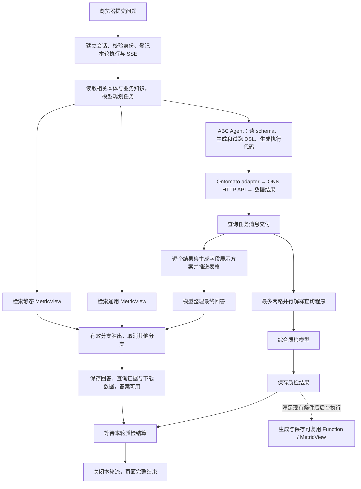

# 页面问数全链路耗时与下一轮优化建议

日期：2026-11-13。分析版本：108 当前部署的 `c188be23`。本轮只做代码/日志分析、资源快照及模型能力探针，没有修改生产代码、模型配置或 ONN Core 目录。

**主要瓶颈是多轮模型调用、查询任务消息交付和质检；这批小结果集的数据库执行不是几十秒等待的主要来源。** 新发现的两个可直接处理的环节是：ABC 查询循环的 10 秒休眠，以及每个结果集展示前的字段语义模型调用。进一步提速应减少模型往返、按任务配置思考模式，并复用经过验证的查询计划。

## 数据来源与时间口径

- 上轮隔离五次、正式五次真实浏览器问数，业务结果、CSV、历史和刷新恢复全部通过；详见 [质检验收](ontomato-quality-check-optimization-20261113.zh-CN.md)。
- 本文主表使用正式质量环境两次相同跨关系题，另外比较客户总数与客户筛选。四轮都有 Workbench 分阶段日志、Java 模型调用日志和查询诊断。
- 正式物流当时沿用自己的 Workbench 基底，缺少同样的分阶段埋点，只有完整时长；不能拿质量环境的比例填充物流各阶段。
- “答案完成”是已存储的回答完成时长；“整轮结束”从浏览器点击至聊天流结束，包含质检及少量浏览器测量开销。模型调用时长包含请求、服务端等待和推理，不是本机 CPU 时间。
- 页面首次加载、浏览器首次绘制、点击至服务端接收、模型服务排队/预填充/解码没有完整独立埋点。不能把现有计时冒充这些指标。
- 第一轮期间有物流部署活动；这是可核查的功能验收样本，尚非专用压测环境或可靠 P95。

## 页面问数流程

图中的“消息交付”概括 DATA 事件及完成事件。实际程序说明在 Java 确认 Agent 完成后启动；多个 DATA 事件可以先后送达。字段展示、答案整理与质检存在重叠，不是所有方框依次串行。

已有静态/通用 MetricView 和 ABC 三路竞争，也已有 SSE、LangGraph 和答案/质检状态区分。下一步应改进已有机制，不能把“引入流式输出、并行查询或 LangGraph”当成尚未具备的新能力。

## 两轮正式跨关系题的完整耗时

问题要求沿客户→订单→产品关系列出全部序列号、升序并统计去重数量，正确结果为 17 个。以下主表各行可以相加；其中“程序生成至结果交付”由 Harness 时长扣除字段整理得到，包含模型、工具、执行和消息交付，不能当成数据库时间。

| 页面阶段 | 正式第一轮/秒 | 正式第二轮/秒 | 具体工作 |
|---|---:|---:|---|
| 任务规划 | 1.875 | 2.319 | 相关 schema、业务知识、一次规划模型调用 |
| 程序生成、试跑、执行及结果交付 | 33.132 | 33.041 | Java ABC Agent 与 adapter；不含下一行字段整理 |
| 字段展示与结果表整理 | 3.713 | 4.929 | 两个结果集分别调用字段语义模型，当前串行等待 |
| 最终回答整理 | 7.706 | 7.543 | 根据已取得的数据生成文字及表格位置 |
| 其余编排/记录差额 | 0.115 | 0.053 | 主计时与上述阶段之差，未进一步归属 |
| **答案完成小计** | **46.541** | **47.885** | 此时回答已可用 |
| 答案后的剩余等待 | 30.790 | 22.412 | 主要是尚未完成的质检，也含结算/浏览器测量开销 |
| **整轮结束** | **77.331** | **70.297** | 质检完成、流结束 |

静态/通用 MetricView 检索与 ABC 同时启动：第一轮分别 32/121 毫秒，第二轮均 23 毫秒，均返回空候选。这些时间已与 ABC 重叠，不能额外加到总时长。连续相同问题仍未命中，说明计划复用值得排查；目前证据不足以断定是生成、保存、索引、作用域还是匹配条件的问题。

前置 schema、知识和模型准备合计第一轮约 207 毫秒、第二轮约 43 毫秒；规划模型本身分别 1.660、2.273 秒。因此并行读取 schema/知识是小优化，收益量级远小于减少后面的模型往返。

## 查询 Agent 的 31 秒具体花在哪里

| 主 Agent 模型调用分组 | 第一轮/秒 | 第二轮/秒 |
|---|---:|---:|
| 查 schema、关系、语法、示例和取值 | 4.094 | 6.788 |
| 生成/修正 DSL，发起试跑 | 11.362 | 8.169 |
| 生成 Python 执行包装并发起测试 | 8.292 | 6.126 |
| 输出说明、提交程序、最终收尾 | 7.867 | 10.204 |
| **模型请求累计** | **31.615** | **31.287** |
| 模型请求次数 | 12 | 11 |

这一表只累计模型请求时长，工具真实执行不在该小计中；一个模型响应可以包含多个工具调用。没有把“模型花两秒决定读取 schema”误当成 schema 数据库查了两秒。

主 Agent 所有轮次的输入 token 累计分别约 15.8 万、13.6 万，是上下文重复发送的累计值，不是单次上下文长度。单次末轮约 1.6 万 token。多轮往返既增加时延，也重复处理上下文。

加上任务规划、两次字段整理、答案整理、两次程序解释及一次综合质检，两轮各约 **19、18 次模型请求**，尚不含质检后生成 MetricView 的后台调用。页面只有一次“问数”，内部并非只请求了一次大模型。

关联到主 session 的 DSL 工具分发分别为 3 次累计 42 毫秒、2 次累计 19 毫秒。轮次日志内可解析的 ONN 成功返回证据分别为 6/7 条、累计约 124/60 毫秒；后者包含试跑/执行等记录，尚未全部具备同一 trace 的精确归属，不是纯 ONN 内核时间，也不能与前者相加。两种口径都不支持把当前几十秒等待归因于数据库。

## 质检如何与回答重叠

| 质检阶段 | 第一轮/秒 | 第二轮/秒 |
|---|---:|---:|
| 两路程序解释的墙钟时间 | 22.700 | 13.340 |
| 综合评审模型 | 18.369 | 20.719 |
| **质检模型链路墙钟总时长** | **41.104** | **34.091** |
| 答案之后仍需等待 | 30.790 | 22.412 |

第一轮以任务规划开始为零点：约第 35.05 秒开始程序解释；字段整理也在第 35.02 秒左右开始；第 38.74～46.45 秒整理回答；综合质检在第 57.79～76.16 秒执行。第二轮质检约第 35.39～69.49 秒执行。以上是服务端统一时钟的阶段偏移，和浏览器总耗时会有入口及采样差额。

因此：

- 不能把 46.5 秒答案时长再加上 41.1 秒完整质检，得到一个虚构的总耗时。
- 单独缩短字段整理和答案润色，可以让答案更早显示；如果质检完成时间不变，整轮可能仍在原时刻结束，答案后的“等待”反而变长。
- 优化共同前段、缩短质检模型链路，才可能同时降低答案时间与整轮时间。

当前每路程序说明仍输入约 1.4 万 token，源码仍注入 `generateWholeDslRule`。精简说明提示词并不等于整个上下文已经精简，仍可根据实际使用的算子裁剪规则。

## 新发现：10 秒休眠导致简单查询空等

[ABCHarnessServiceImpl.java](../packages/data-engine-core/src/main/java/io/ontomato/dataengine/service/impl/ABCHarnessServiceImpl.java) 的循环先 `agentDone.get(1, SECONDS)`，未完成后又 `Thread.sleep(10000L)`。注释提到一秒轮询，但实际一次等待周期约 11 秒，任务已经完成也可能仍在休眠。这与上轮已修复的质检读取忙轮询是两个不同位置。

| 简单查询 | Agent 模型累计 | 最后模型响应→Harness 完成 | 答案完成 | 整轮结束 |
|---|---:|---:|---:|---:|
| 客户总数 | 14.357 秒，7 次 | **7.276 秒** | 27.741 秒 | 39.199 秒 |
| 客户筛选计数 | 15.961 秒，9 次 | **5.593 秒** | 30.802 秒 | 40.210 秒 |

这些间隔包含末尾线程收尾等开销，不能精确全部归为 sleep，但 22/33 秒的交付节奏、代码及完成时间一致指向该轮询机制。两道跨关系题对应尾部间隔仅 94/888 毫秒，所以不能宣称删除休眠会让所有题都快十秒。

建议用按 session 的消息通知与完成信号唤醒消费者，例如 JDK `BlockingQueue` / `CompletableFuture`，以有界等待保留心跳。先做到消息到达和 Agent 完成后及时交付；无需引入 Kafka 或 Redis 队列。需要验证末尾消息排空、顺序、取消、异常、并发 session 隔离，不能仅把 sleep 改成零形成忙轮询。

## 针对性的优化优先级

| 优先级 | 改造项 | 证据与可影响范围 | 实施边界 |
|---|---|---|---|
| P0 | 查询消息改为通知唤醒 | 简单题已有 5.6～7.3 秒尾部间隔；两类时延均可能改善 | 保持顺序、取消与终态语义 |
| P0 | 已知字段优先确定性展示 | 跨关系题当前字段整理 3.7～4.9 秒；每个非空结果集都会请求模型 | 优先采用 schema/输出字段元数据；保留单位、时区、枚举、空值；未知字段再调用模型 |
| P0 | 统一 trace 与时间口径 | 当前有节点埋点，但缺浏览器首表绘制、部分 HTTP/数据库归属、物流同等埋点 | 为后续 A/B 提供完整依据，本身不是几十秒提速手段 |
| P1 | 按用途配置模型思考模式 | 质检和润色仍有显著生成前等待；本轮探针确认网关支持关闭思考 | 查询规划/复杂代码继续使用适合模型；不全局关闭思考 |
| P1 | 简单题结构化计划直达执行 | 客户总数仍有 7 次主 Agent 调用；跨关系题包含生成 DSL 后再次包装 Python | 首批覆盖计数、筛选、排序、限量列表；不满足条件回退现有 ABC |
| P1 | 有选择地预装 schema 与算子规则 | 当前先查询 schema/规则产生 2～3 轮模型往返；解释器仍有约 14k 输入 | 预装最小相关集合，不能重新塞入全部 schema 和全部示例 |
| P1 | 校验后复用查询计划 / MetricView | 相同跨关系题仍走 ABC，重复付出 31 秒模型调用 | 先排查现有生成→索引→检索→匹配链；复用计划后读取当前数据 |
| P2 | 模板回答、先表格后说明 | 跨关系答案整理 7.5～7.7 秒，首文本 token 占 6.9～7.0 秒 | 单一计数可模板化；复杂解释继续用模型；这是答案时间优化 |
| P2 | 质检独立任务和全局模型并发预算 | 当前虽然答案可用，但同一聊天 run 仍等待质检结算；后台 MetricView 也占模型配额 | 区分改善交互和减少计算；保存任务所有权、取消、重连和历史状态 |

两个字段模型调用可以有界并行，但首先应消除不必要调用。把两次调用并行并不能解决简单字段每次仍用模型推断的问题。

已有模型配置的 `query`、`coding`、`general` 等角色当前指向同一个模型配置；Node 的 `createModel` 未传 `role` 时默认 `general`，`agentName` 只用于日志，不能靠改日志名称实现模型路由。细分质检/显示用途需要明确模型绑定的向后兼容设计，不能直接改所有调用的全局参数。

## 本轮模型能力小样本探针

在当前配置的同一模型网关，使用现有综合评审提示词、三道构造的程序说明；每题默认与 `thinking.type=disabled` 各一次，部分顺序交替。没有更改线上模型设置，没有执行新的业务数据查询。

| 构造场景 | 默认耗时/评分 | 关闭思考耗时/评分 |
|---|---|---|
| 明细与去重计数互补且范围正确 | 4.367 秒 / 100 | 1.870 秒 / 95 |
| 遗漏客户过滤 | 6.166 秒 / 45 | 2.085 秒 / 45 |
| 用重复关联行数代替去重产品数量 | 6.491 秒 / 65 | 1.845 秒 / 60 |

六次均返回完整结果；关闭思考的三次响应 `reasoning_content` 为空，默认模式有非空推理输出。三类判断方向一致，评分有变化。当前通过线仍是 60，错误计数案例仍属于“部分满足”，不能宣称系统拒绝了全部错误答案。

这证明当前网关接受并表现出该模式的差异，值得正式 A/B；不能把 1.8～2.1 秒直接当成完整程序解释或线上跨关系质检的新耗时。探针输入约 1.3k token，短于线上说明器的 14k，每题每模式仅一次，未控制供应商缓存/负载，也未覆盖复杂业务规则。

响应已包含 `prompt_cache_hit_tokens`，六次中五次命中 768～1152 token。**提示词缓存已经存在**；下一步应记录命中率、稳定规则前缀、将问题与动态证据放在后段，不是再加 Redis 就能实现模型 KV 缓存。现有正式 LLM 汇总日志没有完整保留这类缓存与推理 token 明细，需要补充。

## 可引入或进一步利用的技术

| 技术 | 适合本项目的用法 | 当前判断 |
|---|---|---|
| JDK 消息队列与完成信号 | 替代 10 秒定时查看任务状态 | 最高确定性的首项，现有依赖足够 |
| 结构化查询计划、JSON Schema 校验、确定性编译 | 模型只生成受限的对象/关系/过滤/聚合计划，编译为现有 DSL；服务器负责字段、方向、权限与分页校验 | 有望显著减少工具轮次，先做简单查询白名单 |
| Strict Tool Calling | 在提供方支持时约束计划对象的形状 | 现有网关 strict 能力尚未实测；不能只给 `writeFile(content: string)` 加 strict 就声称内部 DSL 被约束 |
| 按用途的低思考/非思考模式 | 优先试验字段展示、简单总结、证据明确的质检 | 本轮小样本支持进入完整回归；复杂语义不能直接套用 |
| 提示词前缀/KV 缓存 | 稳定 schema/规则的排列与版本，记录 cache hit/miss | 当前网关已有命中；只能减少输入处理，不能替代输出推理 |
| 带版本和权限范围的计划复用 | 使用现有 PG/MetricView 存储已验证计划；命中后重新读 ONN 当前数据 | 比缓存最终回答更适合业务问数；多实例共享需求明确后再考虑 Redis |
| LangGraph 与现有运行状态管理 | 完善节点边界、恢复、消息更新；后续支持独立质检状态订阅 | 已在使用，重点是改造已有图与持久化，不是再装一个框架 |
| OpenTelemetry + 可选 Jaeger/Tempo | 串联浏览器、Node、Java、Python 和 ONN 客户端 HTTP span，统一 trace ID | 可逐步接入；ONN 内核耗时需服务方提供埋点，不改 ONN 源码也能先测客户端边界 |

Strict JSON 保证形状，不保证业务含义。无论是否使用严格输出，ONN adapter 的谓词、图方向、类型、去重、日期/空值与数据权限校验都要保留。

计划复用键至少考虑数据源/租户、用户授权范围或权限版本、ontology/schema 与 adapter 能力版本、规范化问题及参数。复用的是查询计算逻辑；最终数据/统计仍执行当前读。若要复用结果，另需明确 dataVersion/snapshot 与一致性策略，不能按相似问题直接返回历史数字。

暂不建议为这轮低并发问数引入 Kafka、多 Agent 大规模并行或先部署本地 vLLM/SGLang。前者不解决模型往返和固定等待，后者只有自托管模型/GPU及吞吐需求明确时才有合理评估基础。使用外部模型时，给 108 升 CPU 或 Node 也不能直接缩短远端模型思考。

## 108 环境与数据库侧的判断

本轮只读资源快照：load average 约 0.04/0.10/0.25，16GB 内存中约 8.9GB available；质量 engine/Workbench 当时 CPU 约 0.27%/0.12%，PostgreSQL 约 1.20%。根盘约 82% 使用、可用约 18GB。快照来自空闲时段，不能替代压测期间 CPU、GC、I/O、网络和连接池监控。

现有证据不支持先加机器或换数据库来处理当前 70～77 秒的完整等待。数据库/adapter 优化应针对大结果、深关系、分页和并发另外测量；管理 PG 仍适合保存用户、配置、任务和证据。本轮没有新的 ONN/PG 同题对照，不能把应用层提速表述成 ONN 比 PG 更快。

后台 Function/MetricView 生成在保存质检结果后启动，通常不在当前答案关键路径，但可能与下一题争抢同一模型配额。建议单独记录其排队、速率、重试和生成成功率，采用低优先级、有界并发；先观测，再决定是否调度隔离。

## 推荐实施顺序与验收

1. **通知唤醒 + 展示字段确定性路径 + 埋点。** 不改变问数业务定义，分别提交、分别 A/B。消息就绪/任务完成到交付的 P95 小于 200ms 可作为目标，不是目前已达到的结果；已知列路径应避免额外字段模型调用。
2. **模型用途分配 + 小型结构化查询路径。** 先覆盖计数、等值筛选、排序、去重，复杂表达式/无法确认语义的情况回退 ABC。控制模型调用次数，同时记录不支持比例与回退代价。
3. **验证计划复用 + 独立质检呈现。** 先查明现有重复题为何没有候选，再完善计划注册与匹配；独立质检要保持未完成状态、后台持久化和重连，不能把提前关闭流算作质检计算提速。

准备至少 20 道已知答案题，每个候选与当前版交替各重复 3 次：单表计数、筛选、去重、聚合、日期、空值、空结果、多页、关系方向、两跳/三跳和不支持形状。额外保留缺过滤/错聚合/跨权限负例。先单并发，再测 3 路并发和同会话连续提问。

分别报告：首表可见、完整答案、质检实际完成、整轮结束的 P50/P95/最大值；模型调用数、修复次数、输入/输出/缓存/推理 token；工具/adapter 请求与数据库读、输出行数；质检完成率及对错误语义的识别。样本不足时不宣称 P95 可靠。

每个候选要求业务结果、顺序、去重、CSV、历史、刷新、取消与权限语义不退化；数据/schema/权限变化必须使相关复用失效。性能目标不靠降低评分门槛、隐藏失败、延长超时或返回旧数据达成。完成小规模 A/B 后再决定部署。

## 官方技术参考与证据

- [DeepSeek Thinking Mode](https://api-docs.deepseek.com/guides/thinking_mode)：思考开关和 effort。文档能力需以实际网关兼容性为准，本轮只探测了关闭思考。
- [DeepSeek Context Caching](https://api-docs.deepseek.com/guides/kv_cache)：前缀匹配、命中 token 与 best-effort 语义。
- [DeepSeek Tool Calls / Strict Mode](https://api-docs.deepseek.com/guides/tool_calls)：严格模式、beta 入口及 JSON Schema 子集限制；尚未在本部署验收。
- [LangGraph Streaming](https://docs.langchain.com/oss/python/langgraph/streaming)：图状态、消息和自定义事件流；参考能力说明，不直接复制 Python 示例到本项目 TypeScript。
- [OpenTelemetry 概述](https://opentelemetry.io/docs/what-is-opentelemetry/)：跨服务 trace/metrics/logs 的统一采集，不是自动提速工具。

源码定位：查询休眠在 `ABCHarnessServiceImpl.java:206`；字段模型调用在 `adapter.ts:254`；Node 默认 general 角色在 `model-factory.ts:29`；程序解释注入全量 DSL 在 `UserMessageUtil.getABCProgramDescriberUserMessage`；聊天等待质检在 `api/routes/chat.ts:306`。

本地分析与来源快照：`/Users/weichen/.codex/artifacts/ontomato-query-latency-analysis-20261113/`。`latency-breakdown.json` 为按现有日志计算的阶段汇总，`model-probes.private.json` 为六次能力探针。原始业务记录、提示词内容、密钥和运行配置不进入 Git。
