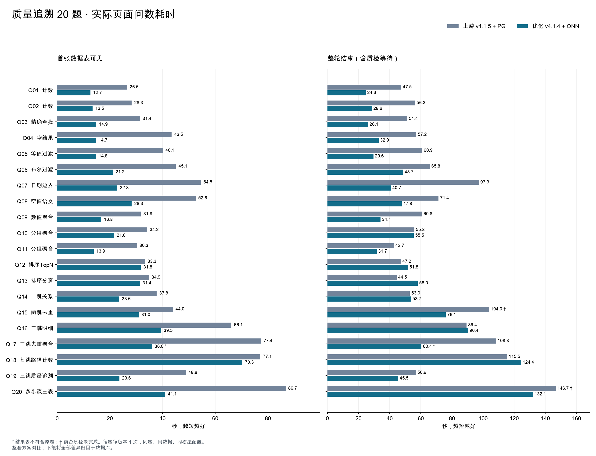

# 质量追溯 20 题：上游 v4.1.5 + PostgreSQL 与优化版 + ONN Core

测试日期：2026-11-13。完成 **40 次真实页面问数**，另执行 **204 次固定 DSL 请求**（34 次预热、170 次测量）。

**结论：当前优化版更早显示数据，平均整轮等待缩短，但准确性验收未全部通过。** 上游结果表 20/20 正确，优化版 19/20；优化版 Q17 在任务规划时扩展了关系范围，错答仍获质检 95 分。应先修复范围保持和质检漏判，再继续压缩模型等待。此次没有改应用代码来重跑或替换不理想成绩。

本次是两个完整问数方案的对比：上游最新 v4.1.5 + PG，对照我们的 v4.1.4 优化版 + ONN。**不能把所有提速解释为 ONN 数据库优于 PostgreSQL。**

## 核心结果

| 指标 | 上游 v4.1.5 + PG | 优化版 + ONN |
|---|---:|---:|
| 完整结果表正确 | 20/20 | 19/20 |
| 要求的列名及多表次序均正确 | 20/20 | 19/20 |
| 前台质检完成 | 18/20 | 20/20 |
| 数据正确且前台质检完成 | 18/20 | 19/20 |
| 历史中保存的数据符合真值 | 20/20 | 19/20 |
| CSV 与实际返回数据逐行一致 | 20/20 | 20/20 |
| 页面异常 / 失败请求 | 0 / 0 | 0 / 0 |
| 答案文字发现问题的题目 | 1：Q17 过程描述失实 | 2：Q14 预览说明失实、Q17 范围错误 |
| 平均首表 | 46.22 s | 26.17 s |
| 首表中位数 | 41.79 s | 23.19 s |
| 平均答案完成 | 46.24 s | 33.81 s |
| 平均整轮结束 | 71.63 s | 54.63 s |
| 整轮中位数 | 58.96 s | 48.22 s |
| 最慢整轮 | 146.71 s | 132.09 s |

全题均值：首表等待减少 **43.4%**，答案完成减少 **26.9%**，整轮减少 **23.7%**。这些全题统计包含错答和质检未完成样本，不能单独作为验收结论。

为避免错误答案和超时结束影响速度判断，再按相同题目比较：

| 配对口径 | 题数 | PG 整轮均值 | ONN 整轮均值 | 等待减少 |
|---|---:|---:|---:|---:|
| 两侧数据均正确 | 19 | 69.70 s | 54.32 s | 22.1% |
| 两侧数据正确且前台质检均完成 | 17 | 63.15 s | 48.47 s | 23.3% |

共同正确的 19 题中，优化版首表全部更早，答案完成 17 题更快、2 题更慢；整轮 14 题更快、5 题更慢。共同完整成功的 17 题排除 Q15、Q17、Q20。错误题不作为成功加速样本。

## 逐题结果

单位：秒。PG/ONN 正确性针对完整结果表，包括指定排序、重复行和多表结果。`†` 表示前台质检未完成；该时间是流关闭时间，不能当成完整成功所需时间。`*` 表示答错。

| 题号 / 内容 | PG 首表 | ONN 首表 | PG 整轮 | ONN 整轮 | PG/ONN 数据 | PG/ONN 质检分 |
|---|---:|---:|---:|---:|---|---|
| Q01 计数 | 26.58 | 12.68 | 47.51 | 24.61 | 正确/正确 | 95/95 |
| Q02 计数 | 28.27 | 13.48 | 56.34 | 28.56 | 正确/正确 | 92/95 |
| Q03 精确查找 | 31.44 | 14.86 | 51.41 | 26.11 | 正确/正确 | 100/98 |
| Q04 空结果 | 43.46 | 14.72 | 57.15 | 32.92 | 正确/正确 | 98/97 |
| Q05 等值过滤 | 40.12 | 14.77 | 60.94 | 29.58 | 正确/正确 | 95/98 |
| Q06 布尔过滤 | 45.08 | 21.22 | 65.82 | 48.67 | 正确/正确 | 70/90 |
| Q07 日期边界 | 54.54 | 22.82 | 97.27 | 40.72 | 正确/正确 | 70/98 |
| Q08 空值语义 | 52.58 | 28.28 | 71.43 | 47.77 | 正确/正确 | 92/98 |
| Q09 数值聚合 | 31.76 | 16.76 | 60.77 | 34.14 | 正确/正确 | 88/97 |
| Q10 分组聚合 | 34.18 | 21.63 | 55.84 | 55.46 | 正确/正确 | 95/88 |
| Q11 分组聚合 | 30.27 | 13.86 | 42.65 | 31.67 | 正确/正确 | 100/95 |
| Q12 排序TopN | 33.33 | 31.77 | 47.17 | 51.75 | 正确/正确 | 100/85 |
| Q13 排序分页 | 34.86 | 31.43 | 44.48 | 58.02 | 正确/正确 | 98/85 |
| Q14 一跳关系 | 37.79 | 23.56 | 52.96 | 53.69 | 正确/正确 | 100/98 |
| Q15 两跳去重 | 43.96 | 31.01 | 103.98† | 76.05 | 正确/正确 | 未完成/85 |
| Q16 三跳明细 | 66.12 | 39.49 | 89.45 | 90.36 | 正确/正确 | 100/68 |
| Q17 三跳去重聚合 | 77.39 | 36.03 | 108.32 | 60.44* | 正确/错误 | 90/95 |
| Q18 七跳路径计数 | 77.11 | 70.30 | 115.53 | 124.45 | 正确/正确 | 100/95 |
| Q19 三跳质量追溯 | 48.84 | 23.64 | 56.90 | 45.47 | 正确/正确 | 98/95 |
| Q20 多步骤三表 | 86.70 | 41.06 | 146.71† | 132.09 | 正确/正确 | 未完成/88 |

[40 次完整指标 CSV](benchmarks/ab20-20261113/runs.csv)、[20 题配对 CSV](benchmarks/ab20-20261113/paired.csv)包含答案完成时间、模型调用、token、质检、历史和 CSV 校验；[汇总 JSON](benchmarks/ab20-20261113/summary.json)便于复算。所有有效样本保留，没有挑选最快结果。

## 发现的问题与原因

### Q17：优化版错误扩展关系范围，质检未识别

原问题明确指定 `supplied_by → uses_batch → creates`，应按这条路径返回 **11 个供应商分组**。优化版的第一层 `Standard Data Query-TaskPlanner` 将问题改写为 `uses_batch (and uses_batch_2/3/4)`。后续编程模型执行四条关系再求并集，返回 **13 组**；原始对象/边复算确认，返回值完整匹配四关系并集，而非用户要求的单关系结果，全部 13 组均与目标表不同或多余。

错误发生在 ONN adapter 执行前。质检面对已被扩展的子问题给了 **95 分**，未发现和原始问题的冲突。固定 DSL 保持原始关系时，两侧均正确返回 11 组，ONN 5/5 测量正确。**当前证据指向规划与质检边界，不是 ONN 查询计算错误。**

同题上游数据正确，但答案过程写“all available batch links”，与实际匹配原始单关系的结果不符，也计为文字说明问题。

### Q15、Q20：上游前台质检超时，后台后来完成

上游两题数据都正确。Q15 答案约 43.98 秒完成，前台在约 103.98 秒结束；Q20 答案约 86.71 秒完成，在约 146.71 秒结束，均对应约 60 秒等待上限。流终态为 `unsettled`，历史接口的质检为 null，稍后再次读取仍未恢复。

后台日志显示 Q15 质检总跨度约 **101.18 秒**，其中最后评分调用 **68.82 秒**；Q20 三份程序解释约 **55.96 秒**，评分约 **40.61 秒**，总跨度约 **96.59 秒**。后台模型返回成功不等于用户收到了结果。

优化版同题前台质检均完成；Q20 首表约 41.06 秒，答案约 62.61 秒，整轮约 132.09 秒。它保留了完成复杂查询及两阶段质检所需的时间。**这仅证明这些样本完成，不代表未来单个模型长时间无进度时一定不超时。**

### Q14：模型证据摘要被误说成页面预览

优化版完整数据、历史、CSV 都有 **127 行**；页面默认显示 10 行，117 行可展开。答案却两次说“预览只显示头尾共 120 行，中间 7 行未显示”。这是模型接收到的摘要窗口被混同为产品界面，可能让用户误以为数据缺失。上游同题没有这一说明错误。

### Q16：质检擅自扩大题意并低估正确结果

两侧都正确返回指定 `uses_batch` 路径的 **94 行**。优化版质检给 68 分，理由包括遗漏 `uses_batch_2/3/4`，但原题并未要求这些关系；另指出分页潜在风险，但本次只有一个 5,000 行窗口中的 94 行。应区分本次实际结果错误、超出题意的假设和更大数据量下的潜在风险。

上述高分错答、低分正确同时说明：质检分数不能替代独立真值测试。现有“分数及格即可可信复用”的规则需要另行明确业务语义后调整。

## 时间主要花在哪里

| 阶段或观察值（每题均值） | PG | ONN | 说明 |
|---|---:|---:|---|
| 初始任务规划模型 | 2.17 s | 2.30 s | 模型改写问题；Q17 错误发生于此 |
| 主 Agent 模型请求累计 | 29.95 s | 24.15 s | 含查询探索与编程，模型耗时之和 |
| 首批数据到页面首表 | 8.35 s | 0.01 s | 上游等待答案整理，优化版先展示表格 |
| 字段准备模型累计 | 2.30 s | 2.39 s | 两侧均 23 次调用 |
| 答案文字模型 | 6.36 s | 6.37 s | 本次几乎没有改善 |
| 程序解释阶段跨度 | 20.08 s | 12.15 s | 优化版减少取代码往返并允许多解释并行 |
| 最终评分模型跨度 | 16.44 s | 15.05 s | 仍有较长尾部 |
| 质检整体跨度 | 36.54 s | 27.23 s | 包含上游在前台超时后的后台执行 |
| 答案后前台等待 | 25.40 s | 20.82 s | 上游两个样本受 60 秒前台上限影响 |

各阶段有并行和重叠，不能简单相加。40 次均通过 ABC 查询分支完成，没有用已有 MetricView 直接替代本次查询。优化版每题均调用 1 次 `getQueryContext`；上游分别读取 schema、DSL 语法、示例，部分题还查询关系，准备往返更多。

| 模型用量（20 题合计） | PG | ONN |
|---|---:|---:|
| 主 Agent 调用 | 215 | 178 |
| 程序解释模型调用 | 45 | 23 |
| 最终评分模型调用 | 20 | 20 |
| 前台关联模型调用（含标题） | 363 | 304 |
| 前台关联模型 token | 3,883,792 | 3,287,240 |
| 后台函数生成调用 | 167 | 144 |
| 后台函数生成 token | 2,012,772 | 1,672,017 |
| 两者合计 token | 5,896,564 | 4,959,257 |

前台关联模型 token 减少 15.4%；含后台生成的总 token 减少 15.9%。这是模型用量，不能直接换算费用，因未取得供应商缓存及计费明细。模型请求日志均为成功，应用执行探针仍发生过错误：上游 16 次、优化版 2 次 DSL 失败埋点；它们均计入用户实际等待，没有作为独立样本剔除。该埋点不覆盖全部 Python 内部查询，不能当数据库总耗时。

具体的慢点：

- **Q12 Top10**：优化版主 Agent 10 次调用、模型累计 28.02 秒；上游 8 次、17.86 秒。完整答案反而更晚，首表提前只有约 1.56 秒。
- **Q13 分页**：优化版主模型累计 28.95 秒，上游 14.48 秒；最终评分约 15.70 对 5.38 秒。固定 DSL 的 ONN 中位数反而略快，说明该题页面退步主要出现在模型流程。
- **Q18 七跳**：优化版主 Agent **26 次**调用，上游 14 次；优化版 10 次独立 `executeDslFile` 和多次试探。优化版评分约 38.46 秒，上游约 17.03 秒。固定七跳查询仅需几十毫秒，关系跳数并非两分钟等待的直接解释。
- **Q20 三表**：优化版主 Agent 14 次、51.74 秒，三份解释跨度约 31.41 秒，最终评分约 43.70 秒。仍需允许完整多步骤查询；用固定轮数截断会损害正确性。优化目标应是重复探索、重复证据和恢复机制。

## 固定 DSL：区分模型等待与数据查询

同一个业务查询，经过各自 Ontomato 的 `/dsl/executeV1` 入口。每格为 **5 次测量的中位数（毫秒）**，各有一次独立预热。已知原始关系与字段，不调用规划和答案模型；因此可以验证 adapter 执行能力，但不是裸数据库比较。

| 题号 / 内容 | PG 中位数 | ONN 中位数 | 正确性 |
|---|---:|---:|---|
| Q01 计数 | 19.91 | 13.27 | 5/5、5/5 |
| Q02 计数 | 21.03 | 13.43 | 5/5、5/5 |
| Q03 精确查找 | 22.54 | 13.12 | 5/5、5/5 |
| Q05 等值过滤 | 20.44 | 15.48 | 5/5、5/5 |
| Q06 布尔过滤 | 能力契约拒绝 | 14.77 | 0/5、5/5 |
| Q07 日期边界 | 能力契约拒绝 | 15.97 | 0/5、5/5 |
| Q08 空值语义 | 23.68 | 15.89 | 5/5、5/5 |
| Q09 数值聚合 | 20.90 | 16.63 | 5/5、5/5 |
| Q10 分组聚合 | 22.70 | 19.78 | 5/5、5/5 |
| Q11 分组聚合 | 22.28 | 27.48 | 5/5、5/5 |
| Q12 排序TopN | 20.67 | 26.42 | 5/5、5/5 |
| Q13 排序分页 | 20.69 | 18.93 | 5/5、5/5 |
| Q14 一跳关系 | 20.23 | 21.03 | 5/5、5/5 |
| Q16 三跳明细 | 22.78 | 24.43 | 5/5、5/5 |
| Q17 三跳去重聚合 | 22.82 | 21.49 | 5/5、5/5 |
| Q18 七跳路径计数 | 34.92 | 23.77 | 5/5、5/5 |
| Q19 三跳质量追溯 | 27.19 | 35.19 | 5/5、5/5 |

ONN 85/85 测量正确。上游 PG 75/85 正确：Q06 布尔 `=`、Q07 datetime `>=` 被 `PostgreAdapter` 的执行能力契约拒绝，尚未下发到数据库；页面问数能通过取数后处理/改写得到正确答案，但增加模型工作。**这不表示 PostgreSQL 不支持布尔或日期过滤。** 测量阶段保留失败记录，后续针对这两个响应做只读诊断，取得 `UNSUPPORTED_OPERATOR_FOR_TYPE` 的明确原因。

共同支持的 15 个查询中，ONN 中位数在 10 个更低，PG 在 5 个更低；差异大多只有几毫秒。七跳计数是 PG **34.92 ms**、ONN **23.77 ms**，但同题页面整轮 ONN 反而更慢。Q19 明细则 PG **27.19 ms**、ONN **35.19 ms**。据此可以说 ONN 当前适配器已能高效执行这批小数据查询，不能说所有关系查询都比 PG 快。

Q04 空结果、Q15 双表和 Q20 三表保留在页面验收中，没有强行改成单条 DSL 纳入辅助测试。[逐次 DSL 数据](benchmarks/ab20-20261113/fixed-dsl.csv)包含预热、所有测量及错误分类。

## 资源观察

仅统计各题前台执行窗口内的容器 CPU 计数差，2 秒采样；内存为同窗口峰值。

| 容器 | PG CPU 累计 / 内存峰值 | ONN CPU 累计 / 内存峰值 |
|---|---:|---:|
| Data Engine | 214.70 CPU秒 / 948.9 MiB | 41.33 CPU秒 / 765.4 MiB |
| Workbench | 8.46 CPU秒 / 252.5 MiB | 8.52 CPU秒 / 271.4 MiB |

这只反映应用容器在本次窗口中的工作量，包含与前台重叠的后台任务，短于采样间隔的部分未精确覆盖。共享 PG 容器同时服务管理库及其他应用，ONN systemd 进程没有同口径资源采样，**不能把此表当两种数据库的总资源排名**。

## 下一轮安排

| 优先级 | 工作 | TDD / E2E 验收要求 |
|---|---|---|
| P0 | 原始问题约束贯穿规划、子问题和质检；明确关系名、过滤、去重、时间边界不能在改写中悄悄扩展 | Q17 单关系应为 11 组；明确要求四关系时才返回 13 组；增加相似关系名反例。先写失败用例，再修改，单关系与四关系正例均保留 |
| P0 | 质检检查原始目标与执行计划差异；语义错误不能只因高分进入可信复用 | Q17 扩展反例必须拒绝，Q16 正确单关系不能要求额外关系；分别确认规则与模型提示调整，保持可解释证据 |
| P1 | 页面完整数据与模型摘要分开命名、记录；答案只描述实际页面和完整结果 | 用 127/191 行 E2E 验证折叠、展开、CSV 与文字；模型摘要缺行不能被说成用户数据缺行 |
| P1 | 质检持久任务、进度恢复和晚到结果回填；保留长任务计算 | 超过 60 秒的单模型调用、多程序解释、断线、刷新、取消及进程重启；最终结论真正完成后才能显示完成 |
| P1 | Q12/Q13/Q18 探索复用和证据压缩；按能力使用排序、分页及聚合 | 正确计划后不重复验证已证实事实；允许必要改写、新证据和任意有效步骤继续，不新增总轮数截断 |
| P2 | 统一上游 v4.1.5 基础后做单变量 A/B、每题多次及并发压测 | 先保留本次基准，再比较同版本、同后端、单开关；同时测试简单、复杂和语义反例，报告分布而非单次最快值 |

本轮没有发现需要修改 ONN Core 才能解决的阻塞缺陷。ONN 团队可后续补充统一 queryId、服务端执行/缓存命中耗时及资源指标，便于分清 HTTP、adapter、服务和数据库内部耗时；这是可观测性需求，不是本轮正确性缺陷。此次未修改 ONN Core 源码、目录、业务数据或服务。

## 对比边界与环境

| 项目 | 上游基线 | 当前优化版 |
|---|---|---|
| 应用源码 | 上游 v4.1.5，`f73467a0cdace41ec5f6133779e985bca95aaeb8` | v4.1.4 + 已部署优化，运行代码 `aa9f4c43` |
| 业务存储 | 同一台服务器的 PostgreSQL 18.6 | 当前质量追溯 ONN 服务 |
| 数据规模 | 29 类、1,979 个对象、54 类关系、5,740 条边 | 相同 |
| 管理与对话数据 | 独立 PostgreSQL 测试库 | 独立 PostgreSQL 测试库 |
| 模型 | deepseek-flash | 同一服务、模型与参数 |
| 质检 | 原生程序解释 + 问题审查 | 已优化的两阶段质检；未启用 fast mode |
| 运行时 | Java 21.0.12.1 / Node 24.18.0 / Python 3.10.22 | 相同 |
| 语言 | 中文问题，界面和引擎 `en` | 相同 |

这里的“上游最新”是开测时核验的 v4.1.5，**并非我们的 v4.1.4 优化前原版**。v4.1.5 本身包含模型 HTTP/1.1、MetricView JSON 选择和答案生成改进。应用版本、适配器、数据库同时不同，因此不能把全部差异归因于 ONN，也不能据此证明某个优化单项的因果收益。

官方镜像拉取速度不足以完成准备，基线改为从上述上游提交的未修改源码构建：替换完整应用实现、前端产物和 Java 依赖闭包，复用匹配的 Node/Python/JRE 运行时。Node lockfile一致；运行时及应用文件另做哈希核验。没有把优化版的实现作为上游基线。

两个测试部署使用独立端口和管理库，业务数据只读。正式 3010/3011 服务、ONN 服务与配置未切换。原始业务对象和关系在测试前后全量核对，逐属性校验；时间按时间点比较，关系按端点集合比较。PG 镜像中的外键只用于表达相同关系，业务字段与 ONN 相同。

## 方法与判分

- 共 20 道固定问题，每个版本每题测量一次，总计 40 次浏览器问数。奇数题先 PG，偶数题先 ONN；前台并发为 1，每题新建浏览器会话。
- 使用真实页面发起问题、接收 SSE、渲染表格；等到完整响应流结束，记录最终质检状态。浏览器执行后另核对历史记录、刷新恢复及 CSV 内容。
- 所有应用超时配置保持不变，测试驱动单题等待上限 900 秒。题目要求完整数据时，不以 TopN、前若干行或样本代替全集。
- 两侧使用新建对话库；引擎配置复制后，既有生成任务、函数和 MetricView 已清空。模型设置一致，保留应用运行中正常的后台函数生成。历史库独立不意味着所有缓存冷启动：预检读过两侧数据，也没有清空共享数据库和服务缓存。
- 预期结果由原始质量追溯对象/关系快照独立计算，并核对现有 PG 镜像；按完整表逐单元格对比，保留重复行，指定排序的题目还检查顺序。数值允许表示格式差异；不能把 null 当成 0，不能把分组值、MIN/MAX 或列名所代表的值互换。
- “数据正确”允许纯列别名差异；“严格列名正确”要求题目所指定别名。多表次序单独检查。模型质检分数不作为正确性判据，另人工核对答案文字中的实质结论。
- 初始两次 Q01 是仪器调试样本：驱动误把答案完成当成包含质检的整轮结束。修正为等待完整 SSE 关闭后重新测量，原调试记录单独保存且不计入 40 次。没有重跑有效的慢样本或错误样本来挑选成绩。
- 题集 SHA-256：`fbc75b782e402d5f15862a9fff97d8840071280a387b220efd976e06f7d828e8`；数据快照 SHA-256：`a7d0d8c6b78f93bd6403a08e6e58347f12d855be4bb7abbbed2c40e596d626a2`。

| 指标 | 定义 |
|---|---|
| 首批数据 | 浏览器收到首个非空 `query_datasets` 事件 |
| 首表 | 页面首次真正显示数据表，不是仅收到数据 |
| 答案完成 | `workflow_complete` 事件；此时质检可能仍在运行 |
| 整轮完成 | 本次问数 SSE 完整关闭，包含等待质检的时间 |
| 主规划模型耗时 | ABC_PROGRAMMER 各次模型请求耗时之和 |
| 质检模型跨度 | 程序解释开始至问题审查模型结束的实际跨度 |
| 答案后等待 | 整轮完成减去答案完成 |

模型调用有并行和交叉，模型耗时之和不能直接视为用户等待时间。后台 READ_FUNCTION_MAKER 不在前台完成等待链上，但也会消耗模型资源；分别计入后台调用和 token。两侧共用模型服务，后台任务可能与下一题重叠，这属于本次保留的原生行为，不是完全隔离的模型服务负载实验。

另外执行固定 DSL 辅助测试：17 个可以统一表达的查询，经 Ontomato 相同 HTTP 入口执行；只翻译存储类路径及关系字段表达，每项每侧 1 次预热 + 5 次测量，交替次序。该测试不调用模型，衡量 HTTP、引擎、适配器及数据库的组合；仍不是裸数据库压测。错误调用不计为“更快”。

## 适用范围

本次是小规模功能与延迟验收。1,979 个对象不代表百万级业务数据；每题每侧只有一个模型样本，不能估计稳定 P95 或模型随机性下的普遍正确率。未测多用户并发、极限吞吐、长时间稳定性、写入事务或故障恢复。

CPU 与内存记录覆盖应用容器和共享 PostgreSQL 容器；没有对 ONN 的 systemd 进程做同口径采样。共享 PostgreSQL 同时承载管理数据，因此资源数据不能用于宣称哪种数据库总体更省内存或 CPU。模型 token 是用量指标，缺少供应商缓存命中和价格信息，不换算账单金额。

## 固定题集与预期

以下为概括；[完整原文题集](benchmarks/ab20-20261113/questions.json)保存实际提交的 20 道中文问题及格式要求。

| ID | 检查内容 | 预期结果 |
|---|---|---|
| Q01 | 客户记录计数 | 42 |
| Q02 | 产品记录计数 | 127 |
| Q03 | 精确技术对象 ID | 1 行 id/sn |
| Q04 | 不存在的客户编号 | 0，而非无结果表 |
| Q05 | E4000 型号过滤 | 13 |
| Q06 | defect_flag=true，排除 false/null | 10 |
| Q07 | 2025 年 1 月、UTC+08 半开时间区间 | 14 |
| Q08 | raw_material_code IS NULL，空串不等于 null | 129 |
| Q09 | 订单数量 SUM/AVG/MIN/MAX | 550 / 10 / 1 / 20 |
| Q10 | 全部型号分组 | 12 组、合计 127 |
| Q11 | 检验结果分组 | 合格 160、不合格 33 |
| Q12 | 振动降序、技术 ID 升序 Top10 | 10 行，逐行顺序一致 |
| Q13 | 相同排序，offset30 / limit20 | 20 行，逐行顺序一致 |
| Q14 | 产品→订单明细 | 127 行，保留全部匹配 |
| Q15 | 客户→订单→产品去重列表及数量 | 17 行 sn + 一行 total17 |
| Q16 | 供应商←批次←装配→产品 | 94 行，保留路径重复 |
| Q17 | 同一路径按供应商去重产品 | 11 组，逐组核对产品数 |
| Q18 | 七跳完整路径计数 | 128，不按终点去重 |
| Q19 | 检验结果→事件→产品→订单 | 191 行完整明细 |
| Q20 | 双客户产品集合三表 | 明细27行；分客户17/10；并集27、交集0、各自独有17/10 |

## 交付与复核

- 上游运行文件核验：引擎 **215** 个文件、Workbench **658** 个文件与构建清单哈希一致；候选镜像 ID 未变化。模型配置、原有角色绑定前后一致。
- 前后全量数据核对：两侧均为 29 类、1,979 对象、54 类关系、5,740 边，所有业务属性和关系一致。
- 40 个会话的流、完整表、历史、CSV、截图和模型日志保存于本地私有目录 `/Users/weichen/.codex/artifacts/ontomato-ab20-20261113/`；服务器证据位于 `/opt/ontomato-ab20-20261113/`。这些路径中的原始数据、配置和日志不进入 Git。
- 测试专用四个应用容器、资源监测和 SSH 隧道已停止。保留隔离管理库与证据供复核。正式 3010/3011 容器 ID、启动时间、重启次数及 ONN 服务 PID/启动状态与测试前相同。
- 本次提交只包含报告、固定问题、汇总数字、CSV 和图表；没有修改应用或 adapter。
