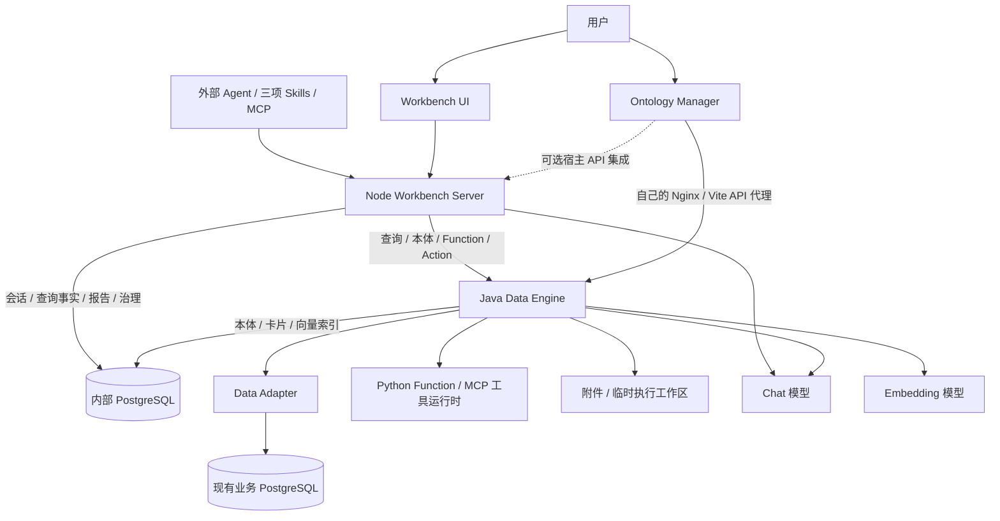
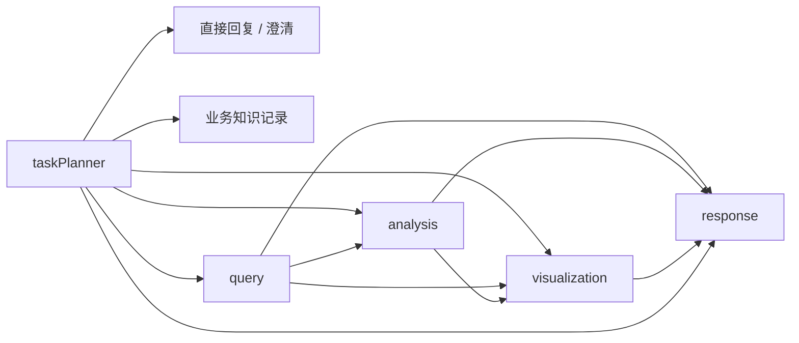

# Ontomato 源码理解与改造地图

本文件记录公开基线的职责边界、执行链路和改造入口，属于接入前的源码研究。后续已新增 ONN 首期只读适配器并完成离线测试及远端只读验证；当前接入范围见[使用说明](onn-core-adapter.zh-CN.md)，服务器问题见[实测报告](onn-core-live-probe-and-team-requirements.zh-CN.md)。

## 1. 基线与理解结论

- 仓库：[vpn2004/Ontomato](https://github.com/vpn2004/Ontomato)，上游为 `Aohan/Ontomato`。
- 阅读基线：`main`，`55fa178991972b9f2e06a65a55882a0d88b4d986`，版本 `4.0.0-beta.1`。
- 核查日期：2026-10-09。已获取全部 7 个公开提交，阅读应用装配、核心服务、UI、部署脚本和三项 agent skill。
- 前期研究阶段执行了离线构建/开发编排契约测试；当时未安装应用依赖、连接业务数据库、配置真实模型或启动完整服务。后续适配器验证记录在上述使用说明中。

**项目核心是把业务含义、查询配方和写操作建立在现有关系型数据库之上，再由 Agent 编排使用，并保存执行证据。** 本体中的对象、属性、关系分别映射到表、列和连接路径；这套“图”不要求另建图数据库。Workbench 组织对话和分析；Java 引擎处理本体、DSL、Python Function、业务写入和向量检索；Ontology Manager 负责建模和数据浏览。

后续改造需要同时考虑三种语义：本体如何解释数据、Agent 如何使用数据、证据如何证明结果。只调整提示词无法替代 SQL 编译器、本体约束或持久化协议的改动。

## 2. 模块与运行边界



| 目录 | 当前职责 | 改造时应放什么 |
| --- | --- | --- |
| `apps/workbench` | Node 公共产品装配，身份、产品、资源和语言策略 | 产品入口及适配器安装 |
| `apps/workbench/web` | 公共 Workbench 浏览器宿主、布局、启动配置 | 产品导航、公共版配置 |
| `apps/ontology-manager` | Manager 独立宿主、API/凭据/偏好注入 | 宿主集成、启动参数 |
| `apps/data-engine` | Java 启动和依赖装配 | 引擎产品依赖与运行配置 |
| `packages/workbench-server` | Express、对话图、分析 Agent、查询事实、治理、诊断 | Node 业务服务与编排 |
| `packages/workbench-ui` | Vue 工作台共享实现 | 聊天、分析、报告、后台与诊断 UI |
| `packages/ontology-manager` | 对象/属性/关系建模，数据浏览，资产编辑 | 本体和资产管理 UI |
| `packages/data-engine-core` | 本体、DSL、LLM 查询、Python、写操作、向量 | Java 核心语义与执行 |
| `packages/data-adapters` | 数据库方言、查询与写入适配 | 数据库支持、SQL 编译 |
| `packages/contracts` | Node 与浏览器共享的 wire contracts | HTTP/SSE 数据结构、状态、事件 |
| `agent-skills` | ontomap-builder、analyst、app-builder，及其独立 CLI | 外部 Agent 工作流与 API 使用说明 |
| `deploy`、`docker`、`scripts`、`dev` | 在线/离线部署，镜像与本地开发编排 | 构建、发行与环境工具 |

技术基线：Node ≥24、pnpm ≥9；Express 4、LangChain/LangGraph、OpenAI 兼容端点；Vue 3、TypeScript、Vite、Element Plus，Workbench 使用 Pinia、ECharts、CodeMirror、G6，Manager 使用 G6 和 X6；Java 21、Spring Boot 3.5.0、LangChain4j 1.13.0/beta23；内部存储使用 PostgreSQL/pgvector，Python ≥3.10。外部 agent skill CLI 的最低 Node 版本是 18，与应用要求不同。

源码存在 PostgreSQL、MySQL、Oracle、SQL Server、Db2、GaussDB、DuckDB 七个 adapter，但**公开 Java 应用只装配 PostgreSQL**。源码模块存在不等于当前产品已支持该数据库。当前产品一套部署使用一个 datasource。

装配顺序也有含义：[Node 入口](../apps/workbench/src/index.ts)先安装 content、product、runtime、identity、i18n 等适配器，再动态导入共享 server。[AGENTS.md](../AGENTS.md)规定 `apps` 管装配、`packages` 管实现，浏览器不能导入 server 实现，本体建模和数据浏览不能在 Workbench 再做一份。

开源身份实现固定为 `userId=system`、`domainId=default`、`roles=[]`，权限 guard 放行。系统保留了 identity/domain 扩展接口，但当前公开版没有登录和实际租户隔离；添加登录按钮不能完成认证改造。`/api/data-query` 和产品代理路径在统一 `/api` authentication 前挂载，新增身份机制时必须一起审视这些入口、Java 入口和 MCP。

入口：[identity.ts](../apps/workbench/src/identity.ts)、[create-app.ts](../packages/workbench-server/src/http/create-app.ts)、[Java app pom](../apps/data-engine/pom.xml)、[根 pom](../pom.xml)、[package.json](../package.json)。

## 3. 本体是什么，如何落库

一个 datasource 的 ontomap 是整份 JSON：`datasetDesc`、`classList`、`classDefs`、`relationshipDefs`。

| 字段 | 实际含义 |
| --- | --- |
| class `name` / attr `name` | 物理表名 / 列名，不能当成任意展示名称改掉 |
| `showName` | 展示名称 |
| `desc` | 提供给模型的业务解释，影响查询规划与字段理解 |
| `attrs[].type` | `varchar/text/int/long/double/date/timestamp/vector` 等声明类型 |
| `relationshipDefs` | `fromClass/toClass/fromField/toField` 定义可命名的连接路径 |
| `inStarChart` | 是否进入相关本体图 |
| `primaryKey` | 对象身份，影响查询定位、向量命中、关系与写入 |
| `bizzKey` | 部分 DSL 输出的业务展示键，并非所有问答路径都会统一应用 |

导入链路为 `POST /admin/setSchema` → `AdminServiceImpl.setPrettyJSONRule` → 转换历史内部字段命名 → `writeJSONRule` 校验 → `JSONRuleDao.save`。内部 PostgreSQL 的 `json_rule(id, content)` 以 domainId 为键，保存整份文档。

**这条导入链路是整份替换，未发现自动合并或本体版本历史。每类必须恰好有一个启用的、声明类型为 `varchar` 的主键属性；缺少 enable 字段按启用处理。** 数值主键、复合主键、版本化本体都需要跨查询、向量、权限或写入链路设计，不能只放宽 JSON 校验。

入口：[ontomap-builder 文档](../agent-skills/ontomato-ontomap-builder/SKILL.md)、[AdminServiceImpl](../packages/data-engine-core/src/main/java/io/ontomato/dataengine/service/impl/AdminServiceImpl.java)、[JSONRuleDao](../packages/data-engine-core/src/main/java/io/ontomato/dataengine/dao/JSONRuleDao.java)。

## 4. 普通对话与查询

普通对话通过 LangGraph 路由：



Planner 支持澄清和历史数据集复用；分析缺少可用数据时先经过查询。查询节点调用共享 `executeBaseQuery`，**同时启动 `static`、`hot`、`abc` 三个分支，第一个有效结果胜出，取消其余分支**。它并不是按“先缓存，失败再推理”串行执行。

- `static`：匹配已发布的参数已绑定 MetricView，执行当前数据，判断是否足以回答问题。
- `hot`：匹配已发布的参数化 MetricView，生成本次参数并执行。
- `abc`：针对新问题做本体推理和执行。支持 `harness`、`no_tool_fixed`、`tool_fixed`；公共默认为 `harness`，默认查询超时 10 分钟。

Harness 向 Java `/abcHarness` 请求执行，并解析 `MESSAGE_TYPE/DATA_TYPE` 帧。Python code、数据集、`outKeyRefs`、后端 session/node 身份都是协议的一部分；缺少 code 会被视为协议错误。更换执行引擎必须保留这些证据和取消语义。

共享执行器负责超时、取消、鉴权错误和部分 ABC fallback。查询节点将执行开始、结果、后端会话关联写入查询事实；质量检查可能稍后补回，因此“回答已显示”“执行成功”“QC 完成”是三个不同状态。

入口：[workflow.ts](../packages/workbench-server/src/services/chat/graph/workflow.ts)、[routes.ts](../packages/workbench-server/src/services/chat/graph/routes.ts)、[base-query-executor.ts](../packages/workbench-server/src/services/data-query/base-query-executor.ts)、[Harness branch](../packages/workbench-server/src/services/data-query/branches/abc-harness-branch.ts)、[system-model.ts](../packages/workbench-server/src/config/system-model.ts)、[model-resolver.ts](../packages/workbench-server/src/config/model-resolver.ts)。模型角色配置从 Java `/businessConfig/getModelSettings` 读取；查询模式等 Node 策略另有运行时配置，两者不可混为一个配置源。

## 5. 深度分析不是普通查询的简单循环

分析 runtime 选择 `dimension` 或 `loop`；分析 Agent 的 regular-session 回合（`conversationTurn`）固定使用 loop。这与上一节标准聊天图的 `analysisNode` 是不同入口，后者对已有数据做分析，并可匹配可执行分析 Skills。**深度分析取数只启用 ABC 分支**，不直接使用普通查询的三路竞速。

| 模式 | 编排方式 | 知识复用与输出 |
| --- | --- | --- |
| dimension | 选取计划，按维度取证据/写报告，再汇总；控制并发，局部失败独立处理 | 可匹配已发布分析报告热卡，用保存的 DSL/ABC 程序查询当前数据；结束后可沉淀待审报告卡 |
| loop | supervisor 使用共享 Agent loop，探查数据、调用 worker、Skills/MCP、创建图表、编辑 notebook | notebook 是报告正文来源；当前这条路径不做报告热卡匹配或卡片沉淀 |

维度模式不是 LangGraph 工作流。报告按计划顺序保存，事件可按完成顺序发送。loop 模型使用展示值证据，原始行和 DSL 留在 runtime/图表能力中；loop 的普通会话回合返回最终回答，分析任务可通过 `reportDeliverableEnabled` 控制报告交付。

Web、定时任务、MCP 都汇入 `task/task-runner.ts`，共享事件、取消与终态处理；run identity 防止旧执行覆盖新执行。分析调度每 30 秒轮询，认领规则并推进下一时隙，再生成一次性报告任务。它与 Java WriteTask 的 cron 写入调度是两套机制。

外部 MCP `/mcp/analysis-agents` 使用 Streamable HTTP，提供 `list_analysis_agents`、异步 `run_analysis`、轮询 `get_analysis_task`、`get_analysis_report_pdf`。另有 `/mcp/ops-agent` 进入诊断 Agent。仓库也有邮件通知实现，本次探索未配置或发送通知。

入口：[标准聊天 analysisNode](../packages/workbench-server/src/services/chat/graph/nodes/analysis-node.ts)、[runtime.ts](../packages/workbench-server/src/services/analysis-agent/runtime.ts)、[dimension workflow](../packages/workbench-server/src/services/analysis-agent/dimension/dimension-workflow.ts)、[loop workflow](../packages/workbench-server/src/services/analysis-agent/loop/loop-workflow.ts)、[task-runner](../packages/workbench-server/src/services/analysis-agent/task/task-runner.ts)、[task-scheduler](../packages/workbench-server/src/services/analysis-agent/task/task-scheduler.ts)、[MCP router](../packages/workbench-server/src/api/routes/analysis-agent-mcp.ts)。

## 6. DSL 到 SQL 的实际边界

主要链路：`DslServiceImpl.executeV1` → DSL 规范化 → `HttpRequestUtil.getM3Data` → 向量命中改写为主键条件 → 行权限条件改写 → `DataAdapter.executeDsl` → `PostgreAdapter.toSql` → JDBC。

`M3`、`mqls` 是历史内部命名；这条路径不要求额外的外部 M3 服务。mqls 存放生成 SQL，SQL 在执行前记录。

当前 PostgreSQL adapter 的重要限制：

- 只取 DSL 数组首项、graph pattern 首项。
- 单步骤查询有独立处理；多步骤分支实际只编译 step 0、1，没有通用的任意长度查询步骤执行器。同一 graph pattern 仍可包含多个对象和关系，不能把此限制解释为最多两跳关系。
- 使用 inner join，表/列标识符直接拼入 SQL，schema 通过 JDBC `currentSchema` 设置。
- 默认 `LIMIT 20000`；查看证据节点另外有 100 条上限，不等于答案计算只处理 100 条。
- DSL 值拼入 SQL；虽然调用 `prepareStatement`，该处未对 DSL 值做参数绑定。
- 每次查询用 `DriverManager` 建连；这个执行方法中未发现连接池或 JDBC query timeout。上层的超时/取消不等于 JDBC 已有相同控制。

因此增加多阶段查询、SQL 方言、聚合能力或大数据性能，需要从实际 compiler 和执行端验证，再同步 DSL 文档、模型提示词、证据与 UI。以上是源码观察，不是已复现的注入或性能故障。

入口：[DslServiceImpl](../packages/data-engine-core/src/main/java/io/ontomato/dataengine/service/impl/DslServiceImpl.java)、[HttpRequestUtil](../packages/data-engine-core/src/main/java/io/ontomato/dataengine/util/HttpRequestUtil.java)、[DslUtil](../packages/data-engine-core/src/main/java/io/ontomato/dataengine/util/DslUtil.java)、[PostgreAdapter](../packages/data-adapters/postgresql/src/main/java/io/ontomato/dataengine/dataAdapter/PostgreAdapter.java)。

## 7. MetricView、Action、Function 与 WriteTask

MetricView/Action 包装通用 Python Function，分别属于 READ/WRITE 操作；它们不是原生数据库 view 或存储过程。

| 资产 | 执行与约束 |
| --- | --- |
| Function | Python code、参数、操作类型、输出字段血缘等定义 |
| MetricView | 命名的参数化读，正式 execute 只执行 PUBLISHED，testExecute 是另一个测试入口；READ 结果实际为 `{"answer":[{...}]}`，输出字段需匹配 `outKeyRefs`，列权限可据此掩码为 `****` |
| Action | 命名的参数化写，只有 PUBLISHED 可执行；对象/关系/向量写入经 `/writeFunctionOperation` 暴露给 Python |
| WriteTask | 包装无参数 WRITE Function 的 cron 任务，记录执行结果、错误和时间 |

Action 的 `POST /action/execute` 是 **multipart**：id、JSON 字符串 param、重复 file 字段。vector 参数的 `uploadFile` 是文件数组索引；Java 创建临时文件路径，并在 finally 中清理。当前 Manager 参数类型列表没有 TYPE_VECTOR，也没有 Action 执行/附件测试界面，后端已有协议，外部应用和 CLI 可调用，后续可补齐前端。

Python 通过真实 subprocess 执行，读取 stdout/stderr，每约 200ms 检查取消/超时并终止进程树。READ 参数携带 userId/domainId/parameterFile，WRITE 使用 sandboxId/domainId/parameterFile。**当前 sandbox 主要是 adapter 的表命名空间，不是 OS 级 Python 隔离**；PostgreSQL sandbox 表使用 sandboxId + className 前缀。若要运行来自不受信任用户的代码，需要另做执行隔离设计。

READ 结果经过 `outKeyRefs` 格式校验与字段权限过滤；WRITE 返回原始 `PythonExecuteResult`，没有同一套输出遮罩。后续接入身份权限时，两种返回协议要分别验证。

Action 保存时不信任客户端代码解释；代码未变可复用保存的解释，代码改变后重新生成，解释失败则保持为空，避免旧解释配新代码。业务含义/代码解释由服务端推导，前端不应另造解释事实。

WriteTask 每分钟同步数据库状态，以 serviceId 表示运行所有权；定时与 runOnce 使用 NOT_SANDBOX。`cancel(false)` 停止未来调度，不取消正在执行的写入。这个实现中未发现分布式租约；多副本部署应另设计认领、幂等和恢复。

入口：[MetricViewServiceImpl](../packages/data-engine-core/src/main/java/io/ontomato/dataengine/service/impl/MetricViewServiceImpl.java)、[ActionServiceImpl](../packages/data-engine-core/src/main/java/io/ontomato/dataengine/service/impl/ActionServiceImpl.java)、[ActionController](../packages/data-engine-core/src/main/java/io/ontomato/dataengine/controller/ActionController.java)、[ABCProgramServiceImpl](../packages/data-engine-core/src/main/java/io/ontomato/dataengine/service/impl/ABCProgramServiceImpl.java)、[PythonExecuteServiceImpl](../packages/data-engine-core/src/main/java/io/ontomato/dataengine/service/impl/PythonExecuteServiceImpl.java)、[WriteFunctionOperationServiceImpl](../packages/data-engine-core/src/main/java/io/ontomato/dataengine/service/impl/WriteFunctionOperationServiceImpl.java)、[WriteTaskServiceImpl](../packages/data-engine-core/src/main/java/io/ontomato/dataengine/service/impl/WriteTaskServiceImpl.java)。

## 8. 对象上的文档与向量属性

一个 vector 属性同时关联三处数据：

1. 业务对象字段：如 `[{"path":"vector-…/uuid.pdf","text":"用于检索的文本"}]`。
2. 引擎附件目录：`conf/vectorResource/<index>/<uuid>.<suffix>`。
3. 内部 pgvector 索引：`vector-<class>-<attr>-<domain>`，保存 brief、path、class/attr、object_id、brief_vector。

**已核查的附件路径要求调用方提供非空 content 用于 embedding，不能由此认定已经实现自动 PDF 解析和分块。** 检索使用 pgvector `<->` 欧氏距离及 KMeans 自动阈值；语义命中转成对象主键 IN 条件，再与结构化过滤合并。

一致性跨内部 PostgreSQL、业务数据库和文件系统：`saveAndAttach` 先读对象属性，再存文件/向量并更新属性，更新失败时尝试补偿删除；`deleteAndDetach` 先删资源再改属性，未发现反向补偿；WRITE `appendVector` 先存文件/向量，再读取并写回对象属性，未见与 `saveAndAttach` 相同的失败补偿。后续扩展批量附件、更新和重试时需要覆盖这些失败阶段，不能视为一个原子事务。本次未复现数据损坏。

embedding 默认维度 2048，同时决定模型请求和向量表结构。已有数据时变更维度需要迁移和重新嵌入。

入口：[VectorResourceServiceImpl](../packages/data-engine-core/src/main/java/io/ontomato/dataengine/service/impl/VectorResourceServiceImpl.java)、[VectorResourceDao](../packages/data-engine-core/src/main/java/io/ontomato/dataengine/dao/VectorResourceDao.java)、[WRITE 操作](../packages/data-engine-core/src/main/java/io/ontomato/dataengine/service/impl/WriteFunctionOperationServiceImpl.java)。

## 9. “记住答案”具体如何实现

当前有真实的持久查询学习和业务知识检索，但发布状态、模型检查、人审、治理建议是不同概念。

### 业务规则知识

聊天 knowledge 节点调用 Java `/knowledge/createknowledgeai`；成功生成非空知识列表时，用新列表替换当前 domain 原有的系统生成待审知识（`creatorType=0/status=0`）。无可用产出时不做这一替换，已发布或人工编辑知识不在替换集合中。`knowledgeindex` 存文本与向量；相似检索只使用当前 domain 的 `status=1` 记录。

### 查询配方学习

- 标准 ABC 的 `saveCard`：DSL evaluation `pass=true` 后异步生成 Function、GENERAL MetricView 和可选 STATIC MetricView；整体 QC 分数在这条路径是元数据，不是准入分数门槛。
- ABC Harness：质量检查评分 **≥60** 后从程序生成 Function 和卡片。
- 自动问答生成的 MetricView 默认 **PENDING_REVIEW**，检索 DAO 只搜索 **PUBLISHED**；Manager 状态下拉及 save 能发布。后端接受状态更新，不能宣称已有强制人审流程。
- 独立自然语言 MetricView 作者路径用 `submitMetricView` 验证 Python 文件已成功 test 且内容未变，之后直接标为 **PUBLISHED**，`persistence=true` 时落库。它与自动问答待审链不同。
- STATIC 复用参数已绑定的 Function；GENERAL 复用参数化 Function。二者都会执行当前数据，不是返回一份永久旧答案。执行后的本次结果写成短期快照，Node 经 `/metricView/getData` 读取。
- 非 SYSTEM 的 PENDING_REVIEW MetricView 距最近修改（`modifyTimestamp`）超过 **12 小时**会被清理，扫描周期 1 分钟；自动生成 Function 的 origin 为 USER，因此自动待审卡也受此期限影响。
- `conf/subQueryWorkspace` 快照超过 **1 小时**清理，扫描周期 5 分钟；Harness V2 临时检查任务也有 1 小时清理期限。这些不是 Node 长期查询事实。

分析报告卡另由 dimension 链路管理，当前 loop 链路未接入。设计统一学习中心时应同时覆盖业务规则、查询 Function/MetricView、分析报告卡的准入、版本、发布、失效与证据。

### 知识治理与通用 memory

Node 治理 Agent 读取业务知识、本体、当前 domain 各用户历史查询和诊断证据，保存覆盖进度、笔记、来源与建议。`update_work_record` 的确认只更新建议，**不修改生产知识、本体或业务数据**；`confirmed` 表示业务含义获接受，不表示已实施。已检查的治理工具中没有治理 → Java MetricView 的 `submit_learning` 路径。Java `submitMetricView` 是另一作者 Agent 的工具。

Node 的 `kv_store/memories` 是通用 JSON store，当前 memories 路由只暴露清理，未发现聊天自动写入和召回接入；Java `ChatMemory` 是进程内 token window。两者都不能替代上面的持久知识与查询配方学习。

入口：[knowledge node](../packages/workbench-server/src/services/chat/graph/nodes/knowledge-node.ts)、[KnowledgeServiceImpl](../packages/data-engine-core/src/main/java/io/ontomato/dataengine/service/impl/KnowledgeServiceImpl.java)、[KnowledgeDao](../packages/data-engine-core/src/main/java/io/ontomato/dataengine/dao/KnowledgeDao.java)、[ChatServiceImpl](../packages/data-engine-core/src/main/java/io/ontomato/dataengine/service/impl/ChatServiceImpl.java)、[CheckServiceV2Impl](../packages/data-engine-core/src/main/java/io/ontomato/dataengine/service/impl/CheckServiceV2Impl.java)、[MetricViewDao](../packages/data-engine-core/src/main/java/io/ontomato/dataengine/dao/MetricViewDao.java)、[MetricViewSubmitTools](../packages/data-engine-core/src/main/java/io/ontomato/dataengine/tools/MetricViewSubmitTools.java)、[SubQueryWorkspaceDao](../packages/data-engine-core/src/main/java/io/ontomato/dataengine/dao/SubQueryWorkspaceDao.java)、[治理 tools](../packages/workbench-server/src/services/knowledge-governance/tools.ts)、[治理 system prompt](../packages/workbench-server/prompts/knowledge-governance/main/system.md)。

## 10. 事实、事件、渲染与存储

| 数据 | 职责 | 改造要点 |
| --- | --- | --- |
| 业务 datasource | 原始对象/关系、业务属性及写操作目标 | 与内部状态库分开；本体映射必须保持物理含义 |
| Java `json_rule` | 整份本体 | 当前整份 upsert，版本化需要新设计 |
| Java `function/metric_view/knowledgeindex` | 执行配方、发布状态、业务规则与向量检索 | 管理来源、准入、状态和失效 |
| Node `query_runs` | 数据集、DSL/IR/code、结果、QC、后端会话、重放计划等执行事实 | 普通问答与分析共用事实模型，不在 UI 或调用方再造结果模型 |
| Node `execution_events` | 阶段、工具生命周期、耗时、失败、来源 | 诊断和过程回放 |
| 聊天渲染快照 | 文本、分析、可视化、澄清等装配结果 | 历史读取合并查询事实/事件；快照不充当证据事实库 |
| checkpoint / harness sessions | Agent 执行上下文、消息、压缩、运行定位 | 不等同于长期业务知识 |
| 分析任务/报告/调度/治理记录 | 各自业务状态与成果 | 避免旧 run 覆盖新 run，取消与终态保持一致 |
| 文件目录 | 附件、执行工作区、报告等 artifacts | 有保留/清理策略，持久引用需要明确生命周期 |

内部 Compose 使用 pgvector PostgreSQL，供 Node 的 `ontomato` 和 Java 的 `datarag` 数据库使用；业务 datasource 通过配置单独连接。一个容器承载多个内部库不意味着它们与业务库共用事务。

查询执行事实的统一构造和持久化回读转换入口是 [query-fact.ts](../packages/workbench-server/src/services/data-query/query-fact.ts)，数据库读写由 [query-run-store.ts](../packages/workbench-server/src/services/data-query/query-run-store.ts) 负责；后台查询历史基于同一结构化列生成展示投影。共享浏览器协议见 [query-execution.ts](../packages/contracts/src/query-execution.ts)、[analysis-events.ts](../packages/contracts/src/analysis-events.ts)。新增事实字段要同步写入、历史读取、SSE、渲染和诊断关联。

## 11. UI、宿主集成与中文化

Workbench 的 `/chat` 统一普通问答、分析任务/报告、dashboard；`/analysis` 重定向。后台包括 Agent、计划、系统 Agent、Skills/MCP、模型配置、示例、审计、反馈、监控；observe 包括诊断、日志、测试用例和 DSL 工作区。

Manager 手动解析 view，而非依赖全局路由，承担 playground 图与路径查找、`/objects`、`/attributes`、`/relations`、`/data/:class`、`/visual-modeling`、`/assets/metrics|actions|functions|tasks`、`/knowledge`。Workbench 通过 iframe 嵌入 Manager，旧页面重定向进去，后续建模改造应集中在 Manager。默认生产 Nginx 和开发 Vite 都将 Manager API 直接代理到 Java；iframe 嵌入影响导航、凭据和偏好传递，不决定 API 去向。

宿主提供 API、身份和偏好。Manager 启动参数可携带 view/focus/id/back/embedded/theme 与凭据；tk/apiKey 收入当前 tab 的 sessionStorage 后立即从 URL 去除。Manager 以 apiBase 与凭据值组成请求身份，变化时重建 workspace 并丢弃旧响应；这是浏览器状态隔离，不代表服务端租户隔离。仅 theme/locale 变化时保留编辑状态，后续请求使用当前 locale。null 凭据停止请求，anonymous 是显式状态；401 清当前 tab 凭据，402 保留。theme/可选 locale 通过 postMessage 同步；发送 target 为 `*`，接收校验 parent/消息/值但没有 origin 白名单，这些偏好消息不携带凭据。

**当前 OSS Workbench、Manager 与 Node 产品策略固定英语，语言切换关闭，实际语言包只有英语。** 中文化需要补齐两套 UI 语言包、应用 profile、Element Plus locale、Manager 偏好同步、公共产品内容；若要求回答/提示词也中文，还需处理 Node/Java 提示词和输出 locale。现有 Java 构建只接受 `PROMPT_LANG=en`，不能直接加环境变量就视为完成。不要随 UI 语言切换改写已保存业务值和标签。

已核实的 UI 改造点：

- DataBrowser 的过滤和排序只作用于已加载页；翻页会清除。CSV 导出当前过滤页且逗号拼接未做转义；Excel 导出是 mock。
- Manager 资产参数类型列表缺 TYPE_VECTOR，且无 Action 执行/附件测试界面；外部应用或 CLI 可用后端 multipart 协议。
- X6 布局 localStorage key 在同源内固定，多个本体布局可能互相影响。
- 对象/属性更新用多个并行请求，可能部分成功；需要考虑恢复和失败展示。
- Markdown 有直接 `marked.parse`，可视化 srcdoc iframe 允许 scripts 与 same-origin。来源信任与内容隔离需要作为具体渲染边界核查；本次没有做漏洞复现。
- 存在较大 Vue 组件，适合按包内职责逐步拆分，避免同时重写宿主和核心执行。

入口：[Workbench main](../apps/workbench/web/src/main.ts)、[Manager shell](../apps/ontology-manager/src/shell.ts)、[Manager credential](../apps/ontology-manager/src/credential.ts)、[Manager profile](../apps/ontology-manager/src/profile.ts)、[iframe entry](../packages/workbench-ui/src/views/admin/OntologyManagerEntry.vue)、[Manager workspace](../packages/ontology-manager/src/ManagerWorkspace.vue)、[Manager Nginx 入口](../docker/ontology-manager/docker-entrypoint.sh)、[Manager Vite](../apps/ontology-manager/vite.config.ts)、[DataBrowser](../packages/ontology-manager/src/data-browser/DataBrowser.vue)、[资产详情](../packages/ontology-manager/src/components/OntologyAssetDetail.vue)、[VisualModeling](../packages/ontology-manager/src/visual-modeling/VisualModeling.vue)、[markdown.ts](../packages/workbench-ui/src/utils/markdown.ts)。

## 12. 开发、部署与 fork 发行

### 本地开发

准备 Node ≥24、pnpm ≥9、Java 21、Python ≥3.10、Docker ≥26 + Compose。按示例准备根 `.env` 与 `apps/data-engine/.env`，Manager 需配置 `DATARAG_ORIGIN` 或相关 API 地址。真实密码、模型 key、运行数据不入 Git。

| 命令 | 实际范围 |
| --- | --- |
| `pnpm install` | 安装 Node workspace 依赖 |
| `pnpm dev` | Node 3000 + Workbench Vite 5173 + Manager Vite 5174；不启动 Java/PG/Python MCP |
| `node apps/data-engine/dev.mjs` | Maven wrapper 启动当前 Java 源码，准备 `.dev`、Python venv；不启动 PG/MCP |
| `pnpm dev:up` | PG → Python MCP → Java ready → 前台 Node/Vite 三进程 |
| `pnpm dev:down` | 结束本 checkout 持有的后台和前台进程，Compose down 保留 volume |
| `pnpm dev:status` / `dev:logs` | 检查本 checkout 进程归属 / 读开发日志 |

`dev:up` 的 Ctrl-C 只结束前台 Node 组，PG/MCP/Java 仍可保留；完整停止使用 `dev:down`。开发 Compose 身份和 volumes 来自 checkout realpath，不同 worktree 分开，但默认端口相同，不能直接假设可同时启动。默认 Java 18087、MCP 18500、PG 5432。

### 部署与镜像

部署端口为 Workbench/API 3000、Manager 3005、Java 18087，PG 5432 仅绑定服务器 loopback。Node 与 Java 各拆 runtime/app 镜像，Manager 是完整镜像；启动时按 compatibility fingerprint 装配。应用代码更新通常只需 app 镜像；依赖变化可能要求重建 runtime 并更新 runtime-lock。

根 Make 的 `build` 做完整构建，`build-app` 只构建应用；`pack` 导出五个镜像包（Node runtime/app、Java runtime/app、Manager），`pack-app` 导出三个应用镜像包；`bundle` 收集某一架构已经构建或导入的镜像及 Compose/安装材料，生成完整离线 bundle。`build-app` 不隐式拉取 runtime；源码 fingerprint 不匹配时提示先重建。构建本身不隐式 git pull 或切换分支。

**当前 fork 的 CI 和在线 Compose 都硬编码 `ghcr.io/aohan`。** 修改 vpn2004 fork 源码后，原在线部署仍拉上游镜像；fork CI 也可能无权推上游包。正式发布改造版前要统一镜像 owner、包权限、compose 默认、版本/tag 与 runtime fingerprint。main 发布 edge；v tag 发布对应版本/latest。

CI 执行 amd64/arm64 镜像构建和启动/健康/HTTP smoke，不能据此认定 TS/Vue 类型、lint、单测及 Java 业务测试全部通过。根 `typecheck:workbench/test:workbench/lint:workbench` 未完整覆盖 Manager 与浏览器检查，后续需要按包选择命令。

入口：[development.md](development.md)、[deploy README](../deploy/README.md)、[online Compose](../deploy/docker-compose.ghcr.yml)、[images.yml](../.github/workflows/images.yml)、[Makefile](../Makefile)、[dev postgres](../dev/postgres.compose.yml)。公开贡献以 `main` 为起点；内部 `develop` 不在此公开仓库，不要导入私有历史或企业实现。

## 13. 本次实际验证及其边界

已运行：

```sh
node --test --test-reporter=spec \
  scripts/build-support.node-test.mjs \
  scripts/product-targets.node-test.mjs \
  scripts/dev-command.node-test.mjs \
  scripts/workbench/runtime-contract.node-test.mjs \
  scripts/workbench/runtime-layout.node-test.mjs

PYTHONDONTWRITEBYTECODE=1 python3 scripts/data-engine/runtime-contract-test.py
PYTHONDONTWRITEBYTECODE=1 python3 scripts/data-engine/sync-product-files_test.py
```

结果：Node 41 项中 40 通过、1 失败；Python 14 项全部通过；合计 **55 项，54 通过，1 失败**。失败在 [product-targets.node-test.mjs](../scripts/product-targets.node-test.mjs)：整份 `.mk` 不得匹配 `LICENSE_MODE|PROMPT_LANG|enterprise` 的断言，被 [product-targets.mk](../scripts/product-targets.mk) 注释中的 `enterprise` 触发；实际 Make 聚合行为测试通过。本次未改这个断言。

以上测试使用临时 fixture/模拟进程，证明的是部分构建与开发编排契约，不是业务运行。当前机器已有 Node 25.9.0、pnpm 9.15.9、Python 3.14.3，缺少 Java runtime、Docker 和应用 node_modules，因此未执行应用 typecheck、Vitest、Java 编译/业务测试或真实全栈联调。

仓库自身部分注释和文档记录了此前的合成 API UI 验证、环境验收限制；那些是源码声明，不能当成本次实际验收。Java 测试中涉及数据库、模型或外部服务的用例需按范围筛选，不能无差别运行全套。

## 14. 后续改造的入口与建议顺序

| 目标 | 主要入口 | 必须一起验证 |
| --- | --- | --- |
| 品牌、中文界面、导航 | app profiles、两套 UI i18n、Element Plus、host 偏好 | iframe 主题/语言同步、编辑状态保持、存量业务值；要求中文回答时再验证服务端输出与提示词 |
| 本体编辑、版本、数值/复合主键 | Manager API、AdminService、JSONRuleDao | 整份替换、查询/向量/关系/写入的身份语义 |
| 问答策略与模型 | taskPlanner、base-query-executor、ABC、model settings | 三路竞争、取消、超时、QC 与证据 |
| 新数据库或复杂查询 | Java app 装配、adapter/compiler | DSL 真实支持、权限、标识符/值处理、连接与结果上限 |
| 文档解析与对象附件 | VectorResource、WRITE、Manager Action UI | 解析/分块、维度、失败补偿、资源清理 |
| 审核与持续学习 | knowledge、Function/MetricView、分析卡、治理工作记录 | 发布门槛、12h TTL、版本/失效、实施与建议区分 |
| 深度分析和报表 | dimension/loop、task-runner、notebook、report contracts | 模式差异、热卡、数据证据、重跑与终态 |
| 认证、用户、租户 | identity、Node proxy/MCP、Manager 凭据、Java 权限 | 所有服务入口、存储 domain、任务归属、服务端校验 |
| 改造版发布 | GHCR owner、CI、Compose、runtime-lock | fork 包权限、app/runtime 匹配、在线/离线更新 |

建议先选一个明确场景建立端到端基线：测试业务库 → ontomap → 问题 → 数据/代码/证据 → 已发布 MetricView 重放 → 一个 Action。再按目标增量修改对应包，保留同一套 contracts 与事实来源。若先重写所有 UI 或执行器，会同时失去可比较的行为基线。

进入具体实现前，需要明确业务场景、部署对象、目标数据库/模型、是否要身份隔离、以及允许写入的范围。这些会决定改造层次；本次探索已建立定位入口，尚未替用户选择产品方向或变更业务行为。
